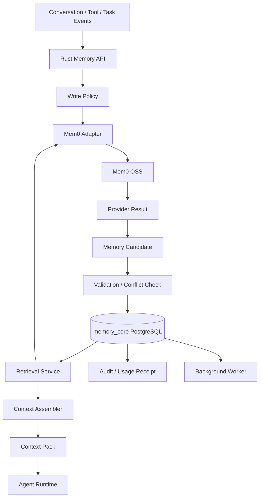
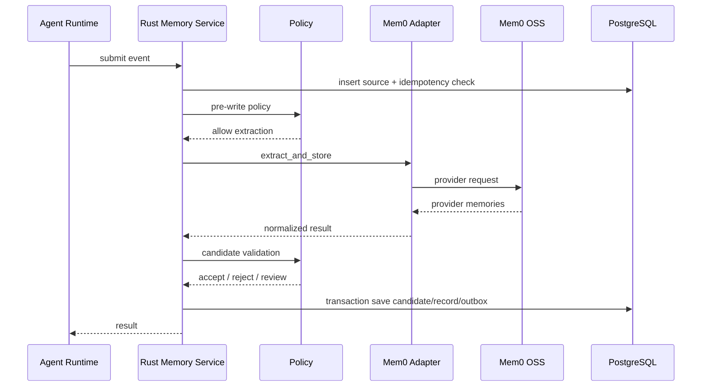
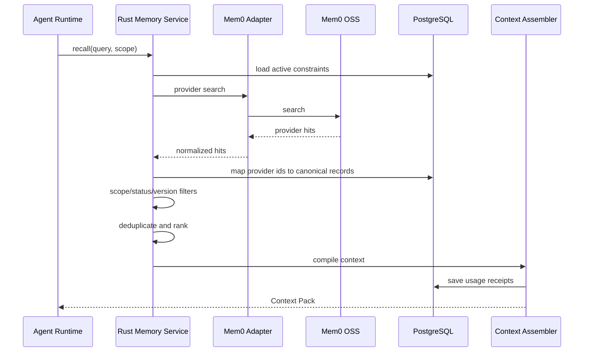

# 记忆系统实现文档

> **状态：历史设计输入，非当前实现规范。** 本文保留早期方案与调研上下文；其中 `extract_and_store`、可变 `memory_records`、可选字段组合 Scope、把安全/权限约束放入 Memory Context 等内容已被修订。开发请从 [`docs/README.md`](../docs/README.md) 开始，并以已接受 ADR、OpenAPI 和编号规范为准。

> 适用范围：Rust Agent 产品、Mem0 OSS 自部署、PostgreSQL + pgvector、两人开发团队  
> 文档目标：指导 POC、MVP 和生产化实现，并明确 Mem0 与自研 Memory Service 的职责边界

---

## 1. 项目目标

本项目需要为 Agent 提供跨会话长期记忆能力，使 Agent 能够：

- 记住用户明确表达的长期偏好；
- 记住稳定的用户信息和项目事实；
- 在后续任务中检索相关记忆；
- 对错误记忆进行修正和删除；
- 控制哪些记忆可以进入本次模型上下文；
- 保证用户、项目和租户之间的数据隔离；
- 保留来源、版本、状态和审计记录；
- 在未来可以替换 Mem0，而不重写 Agent Runtime。

第一阶段采用：

```text
Rust Agent Runtime
        ↓
Rust Memory Service
        ↓
Mem0 Adapter
        ↓
Mem0 OSS
        ↓
PostgreSQL + pgvector
```

---

## 2. 核心设计原则

### 2.1 Mem0 不是最终权威数据源

Mem0 负责：

- 记忆提取；
- 基础去重；
- Embedding；
- 检索；
- 可选 Reranker；
- Provider 内部的数据管理。

Rust Memory Service 负责：

- 是否允许写入；
- 租户、用户、项目和 Agent Scope；
- 记忆状态；
- 来源；
- 版本；
- 有效时间；
- 权限；
- 审计；
- Context 组装；
- 最终是否允许记忆影响 Agent。

PostgreSQL 中的 `memory_core` 数据是业务权威记录。

Mem0 中的数据应被视为：

> 可替换、可重建的智能处理层和检索投影。

---

### 2.2 模型只能提出候选，不能直接修改正式状态

推荐链路：

```text
用户消息 / 工具结果 / 任务结果
              ↓
Mem0 提取或外部提取器
              ↓
Memory Candidate
              ↓
Rust Policy 校验
              ↓
Accepted / Rejected / Needs Review
              ↓
正式 Memory Record
```

对于低风险偏好，可以自动接受。

对于以下内容，应进入审核或更严格的规则：

- 身份和权限信息；
- 企业关键事实；
- 涉及其他用户的信息；
- 程序记忆；
- 来源不清楚的推断；
- 与已有记忆冲突的内容；
- 可能影响真实操作的约束。

---

### 2.3 State、Memory 和 Context 必须分开

```text
State：
当前任务正在执行什么。

Memory：
跨任务、跨会话长期保存的信息。

Context：
本次模型调用实际看到的信息。
```

示例：

```text
“当前任务执行到第 3 步”
→ Runtime State

“该项目要求使用 Node 20”
→ Long-term Memory

“本次调用注入了 Node 20 约束”
→ Context Pack
```

不要把当前任务状态直接写入长期记忆。

---

### 2.4 所有第三方能力必须经过 Adapter

业务层不能直接依赖：

- Mem0 的 ID；
- Mem0 的请求结构；
- Mem0 的过滤格式；
- Mem0 的返回字段；
- Mem0 的数据库表。

业务层只认识自己的领域模型。

---

## 3. MVP 范围

### 3.1 第一版必须实现

- `remember`：提交事件并产生记忆候选；
- `recall`：检索相关记忆；
- `correct`：修正已有记忆；
- `forget`：逻辑删除记忆；
- `get_context`：生成本次 Agent 使用的 Context Pack；
- `inspect`：查看记忆详情、来源和状态；
- 用户、项目、租户隔离；
- 基础记忆版本；
- 来源记录；
- 审计日志；
- PostgreSQL 持久化；
- Mem0 OSS 自部署接入；
- 超时、重试和降级；
- 基础评测集。

### 3.2 第一版暂不实现

- 完整时序知识图谱；
- Graphiti；
- 复杂 Temporal Reasoning；
- 自动 Reflection；
- 自动程序记忆晋升；
- 高级 Memory Decay；
- 多区域高可用；
- 独立向量数据库；
- 多 Agent 共享写入冲突自动合并；
- 模型自动修改正式 Memory Record。

---

## 4. 总体架构



---

## 5. 组件职责

## 5.1 Rust Memory API

对 Agent Runtime 提供统一接口，隐藏 Mem0 的实现细节。

职责：

- 请求认证；
- 参数校验；
- Scope 注入；
- 幂等键生成；
- 调用 Application Service；
- 统一错误码；
- 审计入口；
- OpenAPI 文档。

推荐技术：

- Axum；
- Tokio；
- Serde；
- SQLx；
- Reqwest；
- Tracing；
- thiserror / anyhow。

---

## 5.2 Memory Application Service

负责完整业务流程编排。

核心服务：

```text
RememberService
RecallService
CorrectionService
ForgetService
ContextService
InspectionService
```

它不直接依赖 Mem0 HTTP Client，而依赖 `MemoryProvider` Trait。

---

## 5.3 Memory Policy

负责确定性规则。

包括：

- 哪些事件允许进入记忆提取；
- 哪些类型允许自动接受；
- 哪些内容不应长期保存；
- 冲突时如何处理；
- 哪些 Scope 可以检索；
- 哪些记忆允许进入 Context；
- 是否需要人工审核；
- Retention 和过期规则。

第一版可以采用规则优先、模型辅助的方式。

---

## 5.4 Mem0 Adapter

职责：

- 将内部请求转换为 Mem0 请求；
- 将 Mem0 结果转换为内部领域模型；
- 处理认证；
- 超时和重试；
- 记录 Provider 延迟；
- 屏蔽 OSS 与官方 Platform 的接口差异；
- 屏蔽 Mem0 版本升级差异；
- 保存 `provider_memory_id` 映射。

建议根据自部署实例公开的 OpenAPI 文档生成或校验客户端，不在业务层硬编码第三方接口路径。

---

## 5.5 Memory Repository

负责 `memory_core` Schema 的数据库访问。

Repository 不处理业务规则，只负责：

- 查询；
- 插入；
- 更新；
- 事务；
- 乐观锁；
- 分页；
- 数据库错误转换。

---

## 5.6 Context Assembler

负责将检索结果转换为模型可以使用的上下文。

主要功能：

- Scope 二次过滤；
- 状态过滤；
- 版本过滤；
- 去重；
- Token 预算；
- 记忆类型配额；
- 来源标记；
- 注入顺序；
- 生成 Context Pack；
- 保存 Usage Receipt。

---

## 5.7 Background Worker

负责不适合阻塞主请求的任务：

- Provider 同步重试；
- 缺失索引修复；
- 过期状态更新；
- 物理删除；
- 数据一致性扫描；
- Outbox 事件消费；
- 评测任务；
- 后续 Consolidation；
- 后续 Reflection。

---

## 6. Rust 工程结构

推荐使用 Cargo Workspace：

```text
memory-system/
├── Cargo.toml
├── crates/
│   ├── memory-domain/
│   ├── memory-application/
│   ├── memory-policy/
│   ├── memory-store/
│   ├── memory-retrieval/
│   ├── memory-context/
│   ├── provider-adapters/
│   │   └── mem0-adapter/
│   ├── memory-observability/
│   └── memory-api/
├── apps/
│   ├── api-server/
│   └── background-worker/
├── migrations/
├── deploy/
│   ├── docker-compose.local.yml
│   ├── docker-compose.test.yml
│   └── config/
├── tests/
│   ├── fixtures/
│   ├── evaluation/
│   └── integration/
└── docs/
```

依赖方向：

```text
domain
↑
application
↑
api / worker

application
→ policy
→ repository trait
→ provider trait
→ context trait

store / mem0-adapter
→ 实现 application 中的 trait
```

`memory-domain` 不依赖 Axum、SQLx、Reqwest 和 Mem0。

---

## 7. 领域模型

## 7.1 MemoryScope

```rust
#[derive(Debug, Clone, Serialize, Deserialize)]
pub struct MemoryScope {
    pub tenant_id: String,
    pub user_id: Option<String>,
    pub project_id: Option<String>,
    pub agent_id: Option<String>,
}
```

规则：

- `tenant_id` 必填；
- 用户记忆需要 `user_id`；
- 项目记忆需要 `project_id`；
- 检索时不能由客户端任意覆盖 Scope；
- Scope 应从认证上下文和任务上下文中生成。

---

## 7.2 MemoryType

```rust
#[derive(Debug, Clone, Serialize, Deserialize)]
pub enum MemoryType {
    Preference,
    SemanticFact,
    Episodic,
    UserProfile,
    ProceduralCandidate,
}
```

第一版建议正式支持：

- `Preference`；
- `SemanticFact`；
- `Episodic`；
- `UserProfile`。

`ProceduralCandidate` 只能作为候选，不直接进入执行系统。

---

## 7.3 CandidateStatus

```rust
pub enum CandidateStatus {
    Pending,
    Accepted,
    Rejected,
    NeedsReview,
}
```

---

## 7.4 MemoryStatus

```rust
pub enum MemoryStatus {
    Active,
    Contested,
    Superseded,
    Expired,
    Forgotten,
}
```

说明：

- `Active`：当前可以使用；
- `Contested`：存在冲突，默认不进入 Context；
- `Superseded`：已被新版本取代；
- `Expired`：超过有效期；
- `Forgotten`：逻辑删除。

---

## 7.5 MemoryCandidate

```rust
pub struct MemoryCandidate {
    pub id: Uuid,
    pub scope: MemoryScope,
    pub memory_type: MemoryType,
    pub content: String,
    pub normalized_key: Option<String>,
    pub confidence: f32,
    pub importance: f32,
    pub source_ids: Vec<Uuid>,
    pub provider: String,
    pub provider_memory_id: Option<String>,
    pub status: CandidateStatus,
    pub created_at: DateTime<Utc>,
}
```

---

## 7.6 MemoryRecord

```rust
pub struct MemoryRecord {
    pub id: Uuid,
    pub logical_id: Uuid,
    pub version: i32,
    pub scope: MemoryScope,
    pub memory_type: MemoryType,
    pub content: String,
    pub normalized_key: Option<String>,
    pub status: MemoryStatus,
    pub confidence: f32,
    pub importance: f32,
    pub valid_from: Option<DateTime<Utc>>,
    pub valid_to: Option<DateTime<Utc>>,
    pub supersedes_id: Option<Uuid>,
    pub provider: Option<String>,
    pub provider_memory_id: Option<String>,
    pub created_at: DateTime<Utc>,
    pub updated_at: DateTime<Utc>,
}
```

---

## 7.7 MemorySource

```rust
pub struct MemorySource {
    pub id: Uuid,
    pub source_type: SourceType,
    pub source_ref: String,
    pub content_hash: String,
    pub excerpt: Option<String>,
    pub occurred_at: Option<DateTime<Utc>>,
    pub created_at: DateTime<Utc>,
}
```

来源类型：

```text
ConversationMessage
ToolResult
TaskResult
UserCorrection
ImportedRecord
Reflection
```

---

## 7.8 MemoryUsageReceipt

用于回答：

- 哪次模型调用使用了哪些记忆；
- 为什么这条记忆进入了上下文；
- 最终任务是否成功；
- 该记忆是否真正有帮助。

```rust
pub struct MemoryUsageReceipt {
    pub id: Uuid,
    pub context_pack_id: Uuid,
    pub task_id: Option<Uuid>,
    pub attempt_id: Option<Uuid>,
    pub memory_id: Uuid,
    pub memory_version: i32,
    pub retrieval_score: f32,
    pub rank: i32,
    pub injected: bool,
    pub created_at: DateTime<Utc>,
}
```

---

## 8. 数据库设计

建议同一 PostgreSQL 实例分两个 Schema：

```text
memory_core
mem0
```

`memory_core` 由 Rust 服务拥有。

`mem0` 由 Mem0 自己管理，不允许业务代码直接读取其内部表。

---

## 8.1 memory_candidates

```sql
CREATE TABLE memory_core.memory_candidates (
    id UUID PRIMARY KEY,
    tenant_id TEXT NOT NULL,
    user_id TEXT,
    project_id TEXT,
    agent_id TEXT,

    memory_type TEXT NOT NULL,
    content TEXT NOT NULL,
    normalized_key TEXT,

    confidence REAL NOT NULL DEFAULT 0,
    importance REAL NOT NULL DEFAULT 0,

    provider TEXT NOT NULL,
    provider_memory_id TEXT,
    status TEXT NOT NULL,

    created_at TIMESTAMPTZ NOT NULL DEFAULT now(),
    reviewed_at TIMESTAMPTZ,
    reviewed_by TEXT,

    idempotency_key TEXT NOT NULL UNIQUE
);

CREATE INDEX idx_candidates_scope
ON memory_core.memory_candidates (
    tenant_id,
    user_id,
    project_id,
    agent_id,
    status
);
```

---

## 8.2 memory_records

```sql
CREATE TABLE memory_core.memory_records (
    id UUID PRIMARY KEY,
    logical_id UUID NOT NULL,
    version INTEGER NOT NULL,

    tenant_id TEXT NOT NULL,
    user_id TEXT,
    project_id TEXT,
    agent_id TEXT,

    memory_type TEXT NOT NULL,
    content TEXT NOT NULL,
    normalized_key TEXT,

    status TEXT NOT NULL,
    confidence REAL NOT NULL DEFAULT 0,
    importance REAL NOT NULL DEFAULT 0,

    valid_from TIMESTAMPTZ,
    valid_to TIMESTAMPTZ,
    supersedes_id UUID,

    provider TEXT,
    provider_memory_id TEXT,

    created_at TIMESTAMPTZ NOT NULL DEFAULT now(),
    updated_at TIMESTAMPTZ NOT NULL DEFAULT now(),

    UNIQUE (logical_id, version)
);

CREATE INDEX idx_memory_active_scope
ON memory_core.memory_records (
    tenant_id,
    user_id,
    project_id,
    agent_id,
    status
);

CREATE INDEX idx_memory_normalized_key
ON memory_core.memory_records (
    tenant_id,
    normalized_key
);

CREATE UNIQUE INDEX uq_provider_memory
ON memory_core.memory_records (provider, provider_memory_id)
WHERE provider_memory_id IS NOT NULL;
```

---

## 8.3 memory_sources

```sql
CREATE TABLE memory_core.memory_sources (
    id UUID PRIMARY KEY,
    source_type TEXT NOT NULL,
    source_ref TEXT NOT NULL,
    content_hash TEXT NOT NULL,
    excerpt TEXT,
    occurred_at TIMESTAMPTZ,
    created_at TIMESTAMPTZ NOT NULL DEFAULT now()
);
```

---

## 8.4 memory_record_sources

```sql
CREATE TABLE memory_core.memory_record_sources (
    memory_id UUID NOT NULL,
    source_id UUID NOT NULL,
    PRIMARY KEY (memory_id, source_id)
);
```

---

## 8.5 memory_usage_receipts

```sql
CREATE TABLE memory_core.memory_usage_receipts (
    id UUID PRIMARY KEY,
    context_pack_id UUID NOT NULL,
    task_id UUID,
    attempt_id UUID,

    memory_id UUID NOT NULL,
    memory_version INTEGER NOT NULL,

    retrieval_score REAL NOT NULL,
    rank INTEGER NOT NULL,
    injected BOOLEAN NOT NULL,

    created_at TIMESTAMPTZ NOT NULL DEFAULT now()
);
```

---

## 8.6 outbox_events

```sql
CREATE TABLE memory_core.outbox_events (
    id UUID PRIMARY KEY,
    event_type TEXT NOT NULL,
    aggregate_id UUID NOT NULL,
    payload JSONB NOT NULL,

    status TEXT NOT NULL DEFAULT 'pending',
    attempts INTEGER NOT NULL DEFAULT 0,
    next_attempt_at TIMESTAMPTZ,

    created_at TIMESTAMPTZ NOT NULL DEFAULT now(),
    processed_at TIMESTAMPTZ
);

CREATE INDEX idx_outbox_pending
ON memory_core.outbox_events (status, next_attempt_at);
```

---

## 8.7 audit_logs

```sql
CREATE TABLE memory_core.audit_logs (
    id UUID PRIMARY KEY,
    tenant_id TEXT NOT NULL,
    actor_id TEXT NOT NULL,
    action TEXT NOT NULL,
    resource_type TEXT NOT NULL,
    resource_id TEXT,
    request_id TEXT NOT NULL,
    details JSONB NOT NULL,
    created_at TIMESTAMPTZ NOT NULL DEFAULT now()
);
```

---

## 9. 对外 API 设计

所有 API 均使用内部领域语义，不暴露 Mem0 结构。

---

## 9.1 提交记忆事件

```http
POST /v1/memory/events
```

请求：

```json
{
  "event_id": "evt_123",
  "source_type": "conversation_message",
  "content": "以后技术问题先讲原理，再讲代码。",
  "occurred_at": "2026-07-27T10:00:00Z",
  "scope": {
    "project_id": "agent-platform"
  },
  "metadata": {
    "conversation_id": "conv_1",
    "message_id": "msg_9"
  }
}
```

注意：

- `tenant_id` 和 `user_id` 不应完全信任请求体；
- 服务端从认证信息中补充；
- `event_id` 作为幂等依据之一。

响应：

```json
{
  "request_id": "req_123",
  "candidate_ids": ["candidate_1"],
  "status": "accepted"
}
```

---

## 9.2 查询记忆

```http
POST /v1/memory/search
```

请求：

```json
{
  "query": "用户希望技术问题怎么讲？",
  "scope": {
    "project_id": "agent-platform"
  },
  "memory_types": [
    "preference",
    "user_profile"
  ],
  "limit": 10
}
```

响应：

```json
{
  "hits": [
    {
      "memory_id": "mem_1",
      "logical_id": "logical_1",
      "version": 2,
      "content": "用户偏好技术问题先讲原理，再讲代码。",
      "memory_type": "preference",
      "score": 0.91,
      "source_ids": ["source_1"]
    }
  ]
}
```

---

## 9.3 生成 Context Pack

```http
POST /v1/memory/context/compile
```

请求：

```json
{
  "task_id": "task_1",
  "attempt_id": "attempt_3",
  "query": "给用户介绍 Mem0 的部署方式。",
  "token_budget": 1200,
  "scope": {
    "project_id": "agent-platform"
  }
}
```

响应：

```json
{
  "context_pack_id": "ctx_1",
  "sections": [
    {
      "name": "user_preferences",
      "content": "用户偏好先讲原理，再讲代码。"
    },
    {
      "name": "project_constraints",
      "content": "当前项目使用 Rust，并计划自部署 Mem0 OSS。"
    }
  ],
  "memory_refs": [
    {
      "memory_id": "mem_1",
      "version": 2
    }
  ],
  "estimated_tokens": 83
}
```

---

## 9.4 修正记忆

```http
POST /v1/memory/{logical_id}/correct
```

请求：

```json
{
  "new_content": "当前项目使用 PostgreSQL，不再使用 MySQL。",
  "reason": "用户明确纠正",
  "valid_from": "2026-07-01T00:00:00Z"
}
```

处理：

```text
读取当前 Active 版本
→ 创建新版本
→ 旧版本标记 Superseded
→ 新版本标记 Active
→ 同步 Provider
→ 写审计
```

---

## 9.5 遗忘记忆

```http
DELETE /v1/memory/{logical_id}
```

第一阶段默认逻辑删除：

```text
MemoryStatus = Forgotten
```

同时：

- Context 不再注入；
- 搜索结果被过滤；
- 产生 Provider 删除 Outbox；
- 保留最小审计记录；
- 后续后台任务执行物理清理。

---

## 9.6 查看记忆详情

```http
GET /v1/memory/{logical_id}
```

返回：

- 当前版本；
- 历史版本；
- 来源；
- 状态；
- Provider 映射；
- 最近使用记录；
- 修正记录；
- 删除记录。

---

## 10. MemoryProvider Trait

```rust
#[async_trait]
pub trait MemoryProvider: Send + Sync {
    async fn extract_and_store(
        &self,
        request: ProviderRememberRequest,
    ) -> Result<ProviderRememberResult, ProviderError>;

    async fn search(
        &self,
        request: ProviderSearchRequest,
    ) -> Result<Vec<ProviderMemoryHit>, ProviderError>;

    async fn update(
        &self,
        request: ProviderUpdateRequest,
    ) -> Result<(), ProviderError>;

    async fn delete(
        &self,
        request: ProviderDeleteRequest,
    ) -> Result<(), ProviderError>;

    async fn health_check(
        &self,
    ) -> Result<ProviderHealth, ProviderError>;
}
```

第一版允许 Mem0 同时执行提取和内部存储。

生产加固阶段可以调整为：

```text
Mem0 提取
→ Rust Candidate
→ Rust 接受
→ 再同步到 Mem0 索引
```

后者治理更严格，但开发成本更高。

---

## 11. 写入流程

## 11.1 正常写入


Agent Runtime 把一条事件交给 Rust Memory Service；Rust 先做来源和策略检查，再调用 Mem0 提取记忆；最后由 Rust 决定接受、拒绝还是人工审核，并把正式结果写入 PostgreSQL。

---

## 11.2 写入前规则

不应提交给 Mem0：

- 纯问候；
- 明显临时状态；
- 密码、Token 和密钥；
- 未授权的第三方个人信息；
- 当前任务的中间步骤；
- 大段原始工具日志；
- 可以从 Canonical State 直接读取的数据；
- 重复心跳和系统事件。

第一版启发式规则：

```text
明确偏好表达
→ 高优先级

长期项目约束
→ 高优先级

包含“以后、从现在开始、一直、长期”
→ 提高长期记忆概率

包含“今天、此刻、临时、先”
→ 降低长期记忆概率

工具原始输出
→ 默认不直接记忆

任务最终验证结果
→ 可生成 Episodic Candidate
```

---

## 11.3 冲突处理

示例：

```text
旧记忆：项目使用 MySQL
新信息：项目已经迁移到 PostgreSQL
```

第一版规则：

1. 根据 `normalized_key` 查找当前 Active 记忆；
2. 判断是否是同一逻辑事实；
3. 如果内容一致，忽略或增加来源；
4. 如果是明确更新：
   - 创建新版本；
   - 旧版本标记 `Superseded`；
   - 新版本标记 `Active`；
5. 如果无法判断：
   - 新旧两条标记 `Contested`；
   - 不自动进入 Context；
   - 进入人工审核或后续解决流程。

---

## 12. 检索流程



---

## 12.1 检索前过滤

调用 Provider 前至少确定：

- tenant；
- user；
- project；
- agent；
- memory type；
- 最大结果数；
- 是否包含历史版本；
- 时间范围。

---

## 12.2 检索后二次过滤

即使 Provider 已经过滤，Rust 仍必须再次检查：

- Scope 是否完全一致；
- 对应正式记录是否存在；
- 状态是否为 `Active`；
- 是否是最新版本；
- 是否已过期；
- 是否已遗忘；
- 是否被权限策略禁止；
- 是否符合本次任务目的。

---

## 12.3 排序策略

第一版可以使用：

```text
final_score =
    provider_score
    + importance_weight
    + recency_weight
    + scope_weight
    - contested_penalty
```

其中：

- `provider_score`：Mem0 检索分数；
- `importance_weight`：记忆重要性；
- `recency_weight`：仅对情景记忆明显生效；
- `scope_weight`：项目级精确匹配高于全局用户记忆；
- `contested_penalty`：有争议记录通常直接过滤。

不要对所有记忆统一强衰减。

---

## 13. Context Assembler

## 13.1 Context 分区

建议生成：

```text
[User Preferences]
- 用户偏好技术问题先讲原理，再讲代码。

[User Profile]
- 用户有 C、Java 和 Python 基础。

[Project Constraints]
- 项目使用 Rust。
- 项目要求 Node 20。

[Relevant Past Experience]
- 上次部署失败的原因是 Node 版本不一致。
```

---

## 13.2 注入优先级

```text
P0：安全规则、权限约束、项目硬约束
P1：明确用户偏好、当前有效事实
P2：与任务强相关的历史经验
P3：一般背景信息
P4：弱相关记忆
```

Token 不足时从 P4 开始删除。

---

## 13.3 注入限制

第一版建议：

- 最大注入 8～12 条记忆；
- 用户偏好最多 3 条；
- 项目硬约束最多 5 条；
- 情景记忆最多 4 条；
- 每条记忆限制字符数；
- 相同 `normalized_key` 只保留当前版本；
- 不直接注入 Provider 原始调试字段。

---

## 14. 幂等、重试与降级

## 14.1 幂等

建议：

```text
idempotency_key =
tenant_id
+ source_type
+ source_ref
+ content_hash
+ policy_version
```

重复提交同一事件时，不重复创建正式记录。

---

## 14.2 Provider 重试

建议策略：

```text
连接失败：指数退避重试
429：遵循 Retry-After
5xx：有限重试
4xx 参数错误：不重试
超时：最多重试一次
```

外部写入操作必须配合幂等键或本地映射，避免重复记忆。

---

## 14.3 降级策略

Mem0 不可用时：

### 写入

```text
保存 Source
→ 保存 Pending Candidate / Outbox
→ 返回 accepted_for_processing
→ Worker 后续重试
```

### 检索

```text
优先使用本地缓存或 memory_core 中的基础查询
→ 无结果时返回空记忆
→ Agent 继续执行
```

记忆服务故障不应让所有 Agent 请求完全失败，除非任务明确依赖长期记忆。

---

## 15. 安全设计

必须实现：

- API 认证；
- 租户隔离；
- Scope 由服务端生成；
- Provider API Key 放在 Secret 中；
- 数据库连接加密；
- 日志脱敏；
- Prompt Injection 防护；
- 删除和导出能力；
- 审计；
- 管理接口权限；
- Mem0 Server 不直接暴露公网；
- 生产环境关闭无认证模式。

禁止写入：

- 密码；
- API Key；
- Access Token；
- Cookie；
- 私钥；
- 信用卡完整信息；
- 未授权敏感个人信息。

---

## 16. 可观测性

每个请求至少记录：

```text
request_id
tenant_id
operation
provider
provider_latency_ms
database_latency_ms
candidate_count
accepted_count
rejected_count
retrieval_hit_count
injected_count
context_tokens
error_type
```

核心指标：

```text
memory_write_total
memory_write_failure_total
memory_candidate_accept_rate
memory_duplicate_rate
memory_recall_latency_p95
memory_provider_latency_p95
memory_context_injected_total
memory_provider_sync_backlog
memory_scope_violation_total
memory_forget_failure_total
```

Tracing Span：

```text
memory.remember
memory.policy.precheck
memory.provider.add
memory.candidate.evaluate
memory.repository.commit
memory.recall
memory.provider.search
memory.context.compile
```

---

## 17. 测试方案

## 17.1 单元测试

覆盖：

- Scope 校验；
- Policy；
- 状态流转；
- 版本创建；
- 冲突处理；
- Context Token Budget；
- Provider 错误映射；
- 幂等逻辑；
- 删除逻辑。

---

## 17.2 集成测试

使用真实 PostgreSQL 和 Mem0 测试环境：

- 添加偏好；
- 检索偏好；
- 重复添加；
- 更新偏好；
- 删除记忆；
- Provider 超时；
- 数据库事务回滚；
- Outbox 重试；
- Scope 隔离；
- Mem0 重启恢复。

---

## 17.3 必测业务场景

### 稳定偏好

```text
以后技术问题先讲原理，再讲代码。
```

期望：

- 形成一条偏好；
- 后续技术问题可以召回；
- 不产生多条重复记录。

### 临时信息

```text
我今天在咖啡店办公。
```

期望：

- 默认不进入长期用户画像；
- 可以作为短期情景事件，或直接忽略。

### 偏好变化

```text
以前希望回答简短。
现在技术问题可以详细一些。
```

期望：

- 创建新版本；
- 旧版本不再进入 Context；
- 历史仍可审计。

### 项目事实变化

```text
项目之前使用 MySQL。
现在迁移到 PostgreSQL。
```

期望：

- 当前查询返回 PostgreSQL；
- 历史查询可以查到 MySQL；
- 不同时把两条当作当前事实注入。

### 精确关键词

```text
Node 20
ERR_CONNECTION_RESET
agent-memory-v2
```

期望：

- 能召回包含精确关键词的记录；
- 无关语义记录不应占据 Top 结果。

### Scope 隔离

期望：

- 用户 A 不能检索用户 B 的记忆；
- 项目 A 不能检索项目 B 的记忆；
- Provider 返回错误 Scope 数据时 Rust 能过滤。

### 删除

期望：

- 删除后搜索不到；
- Context 不再注入；
- Provider 删除失败时进入重试；
- 审计记录存在。

---

## 18. 评测指标

### 写入质量

```text
Write Precision
Write Recall
False Memory Rate
Duplicate Rate
Incorrect Update Rate
Conflict Detection Rate
```

### 检索质量

```text
Recall@K
MRR
Relevant Injection Rate
Irrelevant Injection Rate
Current-Fact Accuracy
Scope Isolation Accuracy
```

### 任务效果

```text
Task Success Rate
Memory Helpful Rate
Memory Harm Rate
Answer Consistency
```

### 性能成本

```text
Write P50 / P95
Recall P50 / P95
Context Compile P95
LLM Token per Write
Embedding Cost
Provider Failure Rate
```

---

## 19. 本地部署

开发机：

```text
MacBook M5 Pro
24GB RAM
```

推荐本地组件：

```text
Rust API
Rust Worker
Mem0 OSS
Mem0 Dashboard
PostgreSQL + pgvector
```

LLM 和 Embedding 第一阶段使用外部 API。

Docker Desktop 建议起点：

```text
CPU：6～8 核
内存：8～12GB
磁盘：40～80GB
```

本地 Docker Compose：

```text
services:
  memory-api
  memory-worker
  mem0-server
  mem0-dashboard
  postgres
```

本地只用于开发和 POC，不作为正式产品服务器。

---

## 20. 测试环境部署

小团队测试环境推荐：

```text
1 台云服务器
4 vCPU
16GB RAM
100GB SSD
```

运行：

```text
Rust API
Rust Worker
Mem0
PostgreSQL + pgvector
Dashboard
```

适用：

- 内部 POC；
- 小规模测试；
- 功能验证；
- 低并发 MVP。

测试环境可以单机，但要开启：

- 每日数据库备份；
- 健康检查；
- 日志轮转；
- 服务自动重启；
- 基础监控。

---

## 21. 生产环境部署

小规模正式产品推荐起点：

```text
2 × 应用节点
每台 4 vCPU / 8GB RAM

1 × 托管 PostgreSQL
4～8 vCPU / 16～32GB RAM

200GB SSD 起
```

架构：

```text
Load Balancer
    ↓
Rust API + Mem0 Node 1
Rust API + Mem0 Node 2
    ↓
Managed PostgreSQL + pgvector
    ↓
Backup / PITR
```

Worker 建议独立运行，避免后台任务影响在线请求。

生产要求：

- Mem0 Server 不暴露公网；
- 应用节点无状态化；
- Provider 配置通过 Secret 管理；
- 数据库支持时间点恢复；
- 灰度升级；
- Migration 可回滚；
- 定期恢复演练；
- 压测后再确定最终配置。

---

## 22. 两人团队分工

## 开发者 A：架构与核心逻辑

负责：

- 领域模型；
- MemoryProvider Trait；
- Mem0 Adapter；
- 写入策略；
- 冲突和版本；
- Context Assembler；
- Agent Runtime 集成；
- 评测方案；
- 最终系统联调。

核心交付：

```text
memory-domain
memory-application
memory-policy
mem0-adapter
memory-context
```

---

## 开发者 B：数据与工程基础

负责：

- PostgreSQL Schema；
- SQLx Migration；
- Repository；
- CRUD API；
- Outbox；
- Worker；
- 审计查询；
- Docker Compose；
- 集成测试；
- 部署文档。

核心交付：

```text
memory-store
memory-api
background-worker
deploy
integration-tests
```

---

## 共同负责

- API 和数据模型评审；
- 固定评测集；
- Code Review；
- POC 结果分析；
- 生产压测；
- 安全检查；
- 上线验收。

---

## 23. 开发阶段

## 阶段 0：技术验证

目标：

- 本地启动 Mem0；
- Rust 成功调用；
- 完成 add/search/delete；
- 验证 PostgreSQL + pgvector；
- 跑 20～50 条基础用例。

验收：

- 核心链路可运行；
- 中文偏好可正确提取和召回；
- 本地资源占用可接受；
- Mem0 故障不会破坏权威数据库。

---

## 阶段 1：领域和数据库

目标：

- 完成领域模型；
- 完成数据库 Migration；
- 完成 Repository；
- 完成 Source、Candidate、Record 和 Audit。

验收：

- 版本和状态流转可测试；
- Scope 查询正确；
- 事务一致；
- 幂等可用。

---

## 阶段 2：写入链路

目标：

- 完成 `/memory/events`；
- Mem0 Adapter；
- Candidate；
- Policy；
- 冲突处理；
- Outbox。

验收：

- 偏好写入；
- 重复写入；
- 修改；
- Provider 超时；
- 数据库失败均有测试。

---

## 阶段 3：检索和 Context

目标：

- 完成 `/memory/search`；
- 完成 `/memory/context/compile`；
- Scope 二次校验；
- Token Budget；
- Usage Receipt。

验收：

- 检索正确；
- 不会跨用户；
- 旧版本不注入；
- Context 可追溯。

---

## 阶段 4：修正和遗忘

目标：

- 完成 Correct；
- 完成 Forget；
- Provider 同步；
- 审计；
- 后台重试。

验收：

- 删除后不可检索；
- 新版本生效；
- 旧版本保留审计；
- Provider 不可用时最终一致。

---

## 阶段 5：评测和生产加固

目标：

- 运行固定评测集；
- 性能压测；
- 监控；
- 安全；
- 备份恢复；
- 上线文档。

验收：

- 核心指标达标；
- 无 Scope 泄露；
- 服务可恢复；
- Provider 可替换；
- 数据可导出。

---

## 24. MVP 验收标准

MVP 至少满足：

- 用户明确偏好可以跨会话召回；
- 同一偏好不会反复产生重复记忆；
- 用户修正后新版本生效；
- 删除后不再进入搜索和 Context；
- 用户和项目隔离测试全部通过；
- Mem0 不可用时，在线 Agent 可以降级运行；
- 所有进入 Context 的记忆可追溯；
- 所有正式记忆有来源；
- 业务层不直接依赖 Mem0 类型；
- 可以通过配置关闭 Mem0 Provider；
- PostgreSQL 数据可以独立导出；
- 本地开发环境可一键启动；
- 测试环境可重复部署。

---

## 25. 主要风险

### 风险 1：Mem0 自动写入与业务状态不一致

处理：

- Mem0 结果映射为 Candidate；
- Rust 进行状态校验；
- 正式记录在 `memory_core` 中；
- 不直接信任 Provider 返回。

### 风险 2：重复记忆

处理：

- 幂等键；
- `normalized_key`；
- Scope 内查重；
- Provider ID 映射；
- 评测 Duplicate Rate。

### 风险 3：旧事实和新事实同时进入 Context

处理：

- 版本；
- `Superseded` 状态；
- Context 仅选择 Active 最新版本；
- 有争议事实默认不注入。

### 风险 4：跨租户泄露

处理：

- Scope 从认证上下文生成；
- Provider 检索前过滤；
- Rust 检索后二次过滤；
- 数据库查询必须包含 tenant 条件；
- 安全测试。

### 风险 5：Mem0 升级破坏接口

处理：

- Adapter；
- 固定镜像版本；
- OpenAPI 契约测试；
- 测试环境先升级；
- 数据和 Provider 解耦。

### 风险 6：模型费用和写入延迟过高

处理：

- 只提交高价值事件；
- 写入异步化；
- 批处理；
- 使用较小模型；
- 统计每次写入 Token；
- 设置租户配额。

---

## 26. 后续升级路线

当 MVP 验证后，可以按真实问题升级。

### 时间问题增多

增加：

```text
event_time
valid_from
valid_to
temporal query parser
```

或新增 Hindsight Adapter。

### 无关召回增多

增加：

- 关键词检索；
- Reranker；
- 查询改写；
- 负样本评测；
- 动态阈值。

### 记忆数量过大

增加：

- Memory Decay；
- 归档；
- Consolidation；
- Importance；
- 使用频率；
- 冷热分层。

### 需要经验总结

增加：

```text
Reflection Worker
→ Derived Memory Candidate
→ Policy
→ 正式记录
```

### 需要关系推理

评估：

- Hindsight；
- Graphiti；
- 独立图数据库。

---

## 27. 最终实现原则

> Mem0 负责“记忆智能”，Rust 负责“系统权威”。

具体来说：

```text
Mem0：
提取、基础去重、向量化、检索。

Rust：
Scope、权限、候选、版本、来源、状态、审计、Context。

PostgreSQL：
保存可迁移、可审计的权威数据。
```

这样既能快速完成 MVP，也不会把整个产品绑定在 Mem0 上。
