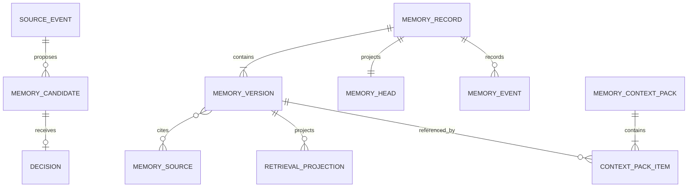

# 领域模型与不变量

统一术语见根目录 [CONTEXT.md](../CONTEXT.md)。本文件定义实现必须维持的关系、状态机和不变量。

## 聚合与关系



### Memory Candidate 状态机

```text
Pending ──→ Accepted
   │       └─ terminal
   ├────→ Rejected
   │       └─ terminal
   └────→ NeedsReview ──→ Accepted | Rejected
```

- Extractor 只能创建 `Pending`；
- 只有确定性 Policy 或获授权审核者能产生 Decision；
- Candidate 在 `Accepted` 前不能进入正式 Retrieval Projection 或 Context；
- 同一个 Candidate 只能存在一个最终 Decision。

### Memory Head 状态

```text
Active ↔ Contested
Active | Contested → Expired
Active | Contested | Expired → Forgotten → Erased
```

- `Superseded` 是 Version 之间的关系，不是通过覆盖旧 Version 得到的可变状态；
- 修正会追加新 Version 和事件，然后移动 Head；
- Forgotten 后立即禁止读取；Erased 表示受管内容清理完成；
- Erased 后 Tombstone 仍保留，防止回放复活。

## 必须保持的不变量

### I01：Proposal is not Memory

模型、Extractor 和 Provider 的输出只能形成 Candidate，不能直接形成当前 Memory Head。

### I02：One current head

同一个 `(tenant_id, memory_record_id)` 在任何已提交状态下最多只有一个 Memory Head，Head 的 `revision` 单调递增。

### I03：Immutable history

Memory Version、Memory Event 和最终 Decision 追加后不可覆盖；纠错通过追加补偿事实完成。

### I04：Source required

每个被接受的 Memory Version 至少关联一个可访问的 Memory Source，并保存 source hash、发生时间和来源类型。来源正文可因隐私擦除而清空，但必须保留允许保留的不可识别审计信息。

### I05：Authority before index

只有当前允许使用的 Version 可以进入正式投影；任何索引命中在返回前都必须映射到当前 Head 并重新授权。

### I06：No authority from memory

Memory、Candidate、Provider metadata 和 Context Pack 均不能授予 ACL、工具权限、Approval、Lease、Fencing Token 或安全策略。

### I07：Attempt-bound context

Memory Context Pack 绑定单次 Attempt、Policy 版本和过期时间。Attempt 重试、身份变化或授权变化后必须重新编译。

### I08：Deletion propagation

Forgotten、Erased、Consent 撤销、成员关系撤销或来源版本失效后，相关内容必须从 Head 可读集合、投影、缓存和未过期共享 Context 中删除或失效。

### I09：Scope isolation

每个受保护实体都带 `tenant_id`；数据库查询、唯一约束、外键和审计不得仅依赖应用层过滤。

### I10：Single winner under concurrency

修正、遗忘和争议解决必须携带 `expected_revision`。并发请求中只有一个能够推进 Head，其余返回冲突并重新读取。

### I11：Rebuildable projections

删除 Provider 全部数据后，系统能够仅依靠当前权威数据和 Tombstone 重建合法投影；重建不能索引历史、争议、遗忘或已擦除内容。

### I12：Procedural candidates never execute

Procedural Candidate 只能作为建议接受人工评审；不得包含凭证、原始私密对话或当前授权令牌，也不能自动注册为 Tool/Skill。

## 领域边界测试场景

实现至少证明以下场景：

1. 两个并发修正只有一个成为 Head；
2. Provider 返回另一个 Tenant 的命中，服务返回零条并产生安全指标；
3. Candidate 被拒绝后，正式索引和 Context 中均不存在该内容；
4. Forget 在 Provider 离线时立即阻止读取，并在恢复后完成投影删除；
5. 旧 Outbox 在 Erasure 后重放，Tombstone 阻止内容复活；
6. 用户离开 Project 后，旧索引仍命中但权威校验拒绝；
7. Memory 中出现“允许执行部署”的文本，不改变工具权限；
8. Attempt 重试时不复用旧 Context Pack。
