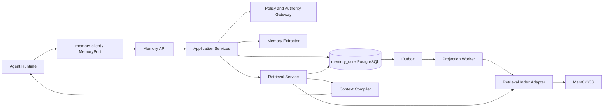

# 系统架构与信任边界

## 组件视图



### Rust Memory Service

持有领域规则、Authority 校验、Memory Ledger、Context 编译、审计和 Provider Adapter。它是唯一允许推进 Memory Head 的服务。

### PostgreSQL `memory_core`

保存 Source Event、Candidate、Decision、Record、Version、Ledger Event、Head、Consent 引用、Tombstone、Outbox、Projection Receipt 和 Usage Receipt，是业务权威数据源。

### Mem0 OSS

第一阶段候选 Provider。它可以实现 Extractor、Retrieval Index 或 Reranker，但每项能力必须通过独立接口接入。它的数据是可重建投影，不参与 Authority Decision。

### Agent Runtime

提供 Task、Attempt、当前身份、Purpose、Canonical State 引用和 token budget。Runtime 必须把 Memory Context Pack 当作有来源但不可信的背景数据，而不是系统策略。

### `memory-client` / `MemoryPort`

提供 Runtime 到 Memory API 的类型化边界、有界幂等重试、HTTPS/Bearer 约束，以及
Context Pack Manifest/Consume 契约复核。`apps/demo-agent` 已迁移为参考接入；正式
Runtime 接入与独立验收见 [Agent Runtime 集成契约](./15-agent-runtime-integration.md)。

## 信任边界

| 边界 | 输入信任级别 | 必须执行的控制 |
|---|---|---|
| Client → Memory API | 不可信 | 认证、限流、Schema 校验、幂等、Scope 收窄 |
| Runtime → Memory API | 部分可信 | 校验服务身份、Task/Attempt 归属、Purpose allowlist |
| Source content → Extractor | 不可信 | Secret/PII 检测、大小限制、允许用途、Prompt Injection 标记 |
| Extractor → Candidate | 不可信模型输出 | 结构校验、类型/Scope 校验、确定性 Policy、必要时审核 |
| Provider → Retrieval Service | 不可信投影结果 | ID 映射、当前 Head、Authority、Consent、状态二次校验 |
| Memory Context Pack → Model | 不可信数据 | 明确数据边界、引用来源、禁止解释为系统指令 |
| Worker → Provider | 外部副作用 | 幂等 operation ID、租约、退避、回执、Tombstone 检查 |

## 依赖方向

```text
domain
↑
application → policy/authority ports
↑             repository/extractor/index/reranker ports
api / worker

store、mem0-adapter、http-api 实现端口
```

`domain` 不依赖 Axum、SQLx、Reqwest、Mem0 或具体模型 SDK。`application` 不得直接读取 Mem0 数据库。

## 禁止的架构捷径

- Agent Runtime 直接调用 Mem0；
- Provider ID 成为业务 Memory ID；
- 先正式索引、后决定是否接受；
- 从 Memory Context Pack 读取权限或安全规则；
- 只依赖 Provider metadata 进行租户隔离；
- 为追求实时性在数据库事务中调用模型或 Provider；
- Provider 故障时绕过 Authority 校验返回原始命中。
