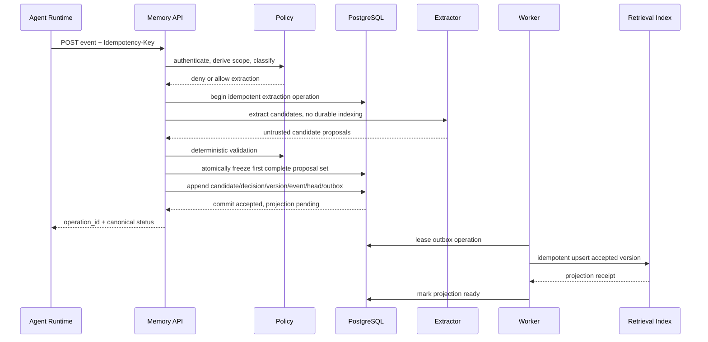
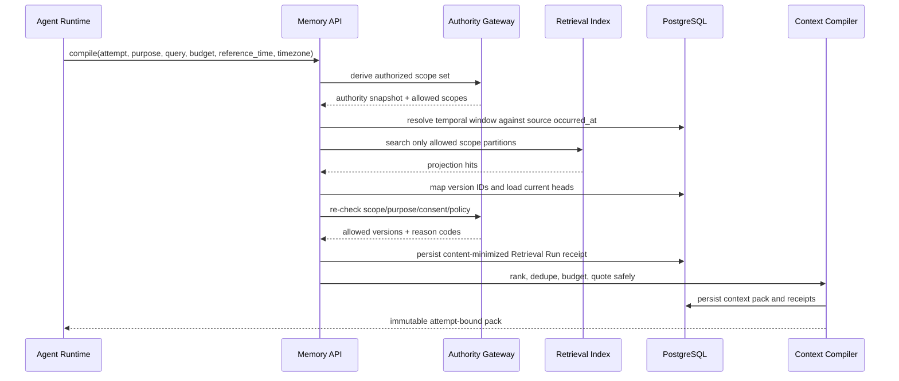

# 写入、读取、修正和遗忘流程

## 通用事务原则

推进 Memory Record 的唯一事务形态是：

```text
Lock → Guard → Decide → Append → Reduce → Outbox → Commit
```

- `Lock`：按 `(tenant_id, memory_record_id)` 加锁或校验 `expected_revision`；
- `Guard`：重新验证身份、Scope、Consent、Policy、状态和 Tombstone；
- `Decide`：产生确定性的领域结果；
- `Append`：追加 Version、Decision 和 Memory Event；
- `Reduce`：更新 Memory Head 读取投影；
- `Outbox`：写入幂等投影操作；
- `Commit`：一次提交。

模型、Mem0、消息发送和对象存储调用必须在事务外。

## 1. Source Event 与候选写入



同一主 Idempotency-Key 的 request hash 必须绑定 Principal、来源、正文、发生时间、
候选上限和 scope。零候选也要完成快照。模型超时后可在相同 Extractor 版本下重试；
首个完成者固化后，所有并发/后续请求复用同一候选集合。每个候选再派生稳定子 Key，
因此候选入库中途失败也可安全补齐，不能重新接受另一组模型输出。

### 响应语义

- `202 accepted_for_processing`：Source Event 已幂等接收，候选尚未最终决定；
- `200 candidate_rejected`：已决定不形成正式记忆；
- `200 needs_review`：等待人工审核，不得索引；
- `201 memory_accepted`：Version 与 Head 已提交，投影可能仍为 Pending；
- `projection_ready` 只能通过 operation 查询或后续事件确认。

禁止用一个含糊的 `accepted` 同时表达“HTTP 已接收”“Candidate 已接受”和“索引已可检索”。

## 2. 人工审核

1. 审核者必须具有 Candidate 所在 Tenant/Scope 的 review 权限；
2. API 携带 `expected_candidate_revision` 和幂等键；
3. 重新执行当前 Policy，而不是沿用创建 Candidate 时的授权；
4. Accept 时在一个事务内追加 Decision、Memory Version、Ledger Event、Head 和 Outbox；
5. Reject 时只追加最终 Decision 和审计，不创建正式投影。

## 3. 检索与 Context 编译



要求：

- Provider 不可用时 MAY 使用本地 FTS 精确检索；没有合法结果时返回空 Pack；
- 相对时间查询必须绑定明确时区；可回放调用应显式传 `reference_time`，时间过滤使用
  Source Event `occurred_at` 的半开区间，不使用事实 `effective_from` 代替；
- 对声明 `memory_required=true` 的 Task，无法完成权威检查时返回 `MEMORY_UNAVAILABLE`，不得静默继续；
- 权限不确定、版本陈旧、争议或已遗忘一律省略；
- 直接 Search 必须返回 `retrieval_run_id`；逐通道候选、RRF、Rerank、pre/post 授权和
  排除理由只允许 `memory:admin` 查询，回执不得保存原始 Query 或记忆正文；
- Agent Runtime 重试 Attempt 时必须重新编译。

## 4. 修正

请求必须包含 `expected_revision`、reason、来源和幂等键。

```text
load and lock Head
→ re-authorize actor
→ reject if expected_revision mismatches
→ append new immutable Version
→ append MemoryCorrected event
→ move Head to new Version and increment revision
→ enqueue delete/upsert projection operations
→ commit
```

旧 Version 不修改。旧索引删除与新索引 upsert 使用同一个 ordering key；Worker 在执行前读取 Head，避免旧操作覆盖新版本。

当前 user/preference Correction 已实现：

- Tenant 级幂等请求指纹与稳定 operation；
- Head `FOR UPDATE`、`expected_revision` 并发单赢家；
- 新 Decision、Source、Version、`MemoryCorrected` Event、Head 和 Outbox 同事务提交；
- 所有引用旧 Version 的未失效 Context Pack 立即标记 `MEMORY_CORRECTED`；
- Worker 创建新投影后删除同 Record/generation 的旧 Provider 对象，本地 FTS
  同样只保留当前 Version；
- 重放相同请求返回同一 operation，变化后的请求或陈旧 revision 返回 Conflict。

该实现尚不等于争议解决；不同来源冲突仍需第 5 节的 `Contested` 与 Review 链。

## 5. 争议解决

- 无法自动判断的冲突追加 `MemoryContested`，Head 状态变为 `Contested`；
- Contested 默认不进入 Context；
- 审核者选择现有 Version 或追加新 Version 后，追加 `MemoryContestResolved`；
- 解决操作使用 `expected_revision`，并重建该 Record 的投影。

当前 user/preference 争议链已实现：

- semantic advisory lock 和 live identity 唯一索引保证同一 Record 同时最多一个
  open review Candidate；
- 冲突 Source、Candidate、NeedsReview Decision、`MemoryContested`、Head revision、
  Pack invalidation 和 projection delete 在同一事务提交；
- Contested Head 不属于 authorized read set，即使 Provider 删除尚未完成也不注入；
- Review API 使用 Candidate revision 与幂等请求指纹；接受追加 Version，拒绝保留
  原 Version，并将 Head 恢复 Active；
- 同一 Record 的 Outbox 严格按创建顺序领取，避免 contest delete 越过 review
  upsert；review upsert 最终清理同 generation 的旧 Provider 对象；
- 接受、拒绝、幂等重放和并发单赢家均有真实 PostgreSQL 测试，接受路径另有
  HTTP + Mem0 端到端证据。

## 6. Expiry、Forget、Export 与 Erasure

### Expiry：到期后自动停止使用

Worker 定期锁定当前 `Active` Head，并检查当前 Version 的 `retain_until` 和
`effective_to`：

```text
select due Active Head with SKIP LOCKED
→ Head = Expired, revision + 1
→ retire live semantic identity
→ append MemoryExpired
→ invalidate Context Pack
→ enqueue projection delete
→ commit
```

事务提交后权威读取立即拒绝该记录；Worker 随后删除 Mem0 和本地 FTS 投影。Expired
Head 保留当前 Version，便于用户检查和导出，但不能重新激活。重复扫描不会重复建立
事件或删除 operation。

### Forget：立即停止使用

```text
authorize
→ append MemoryForgotten
→ Head = Forgotten, revision + 1
→ write Tombstone
→ enqueue projection/cache invalidation
→ commit
```

事务提交后，权威读取必须立即拒绝该记录，即使 Provider 删除尚未完成。

### Export：同一快照中的可移植记录

`GET /v1/memory/export` 在一个 `REPEATABLE READ READ ONLY` 事务中导出当前用户所有
非 Erased 记录，包括 Active、Contested、Expired 和 Forgotten Head，以及完整
Version、Source reference、Policy/retention 元数据和 Ledger Event。客户端不能通过
查询参数扩大授权范围；Erased 记录和其他用户记录不会进入导出。

### Erasure：删除受管内容

Erasure 是可跟踪工作流：

1. 创建 `erasure_request`；
2. Head 进入 Erased 并写 Tombstone，立即停止所有权威读取；
3. 清除允许擦除的 Source excerpt、Version/Candidate content、Context snapshot；
4. 立即删除本地 FTS，并通过 Outbox 删除 Provider/vector/cache 投影；
5. 记录每个 Record/投影处理器进度；
6. 所有投影删除完成后 Request 标记 Complete，仅保留不可识别审计事实。

当前运行实现支持 `memory_record`、当前 `user` 和 Principal 已获授权的 `project`。
Project target ID 只用于授权和定位，持久化 Request 保存其 hash；移除 Project
membership 后不能读取旧 Pack 或创建新的 Project Erasure。生产环境仍需把签名
claim 接到具有撤权事件和新鲜度保证的外部 membership authority。

备份中的删除遵循文档化保留期；恢复备份时必须先回放 Tombstone/Erasure 日志再开放服务。

## 7. 投影重建

1. 使用 `memory:admin` 和稳定 `Idempotency-Key` 为 Tenant 建立
   `building` generation；
2. 在 Tenant generation advisory lock 下冻结普通 Accept/Correct/Review 写入；
   旧 `active` generation 继续服务读取；
3. 从 PostgreSQL 当前 Active Head 读取合法 Version，排除 Contested、过期、
   Forgotten、Erased 和 Tombstone；
4. 每条 Version 创建稳定 Projection Operation + Outbox，写入隔离的新 generation；
5. Worker 通过 fencing 完成后累计 ready/failed；全部 ready 才进入 `ready`；
6. Activation 在同一事务中对比 canonical/local 数量、Head revision 和 content hash，
   再把旧 generation 置为 `standby`、新 generation 置为 `canary`；
7. Canary 读取验证通过后 `finalize`，新 generation 成为 `active` 并解除写冻结；
   否则 `rollback` 原子恢复 standby；
8. `abort` 或任何 Forget/Erasure 会使未激活重建失败；终态删除 Worker 会遍历所有
   已知 generation 清理 Provider 对象，避免失败 generation 遗留敏感正文；
9. Retired/failed generation 的物理批量清理必须在保留窗口和对账完成后执行。

重建不得从聊天记录、旧 Provider 索引或 Candidate 反向生成正式记忆。
当前实现选择“短写冻结 + 持续读”保证首版重建正确性；零停写的 snapshot + delta
catch-up 留作后续容量优化，不得在未实现双写/增量追平时直接取消冻结。
