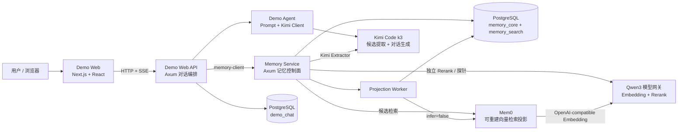
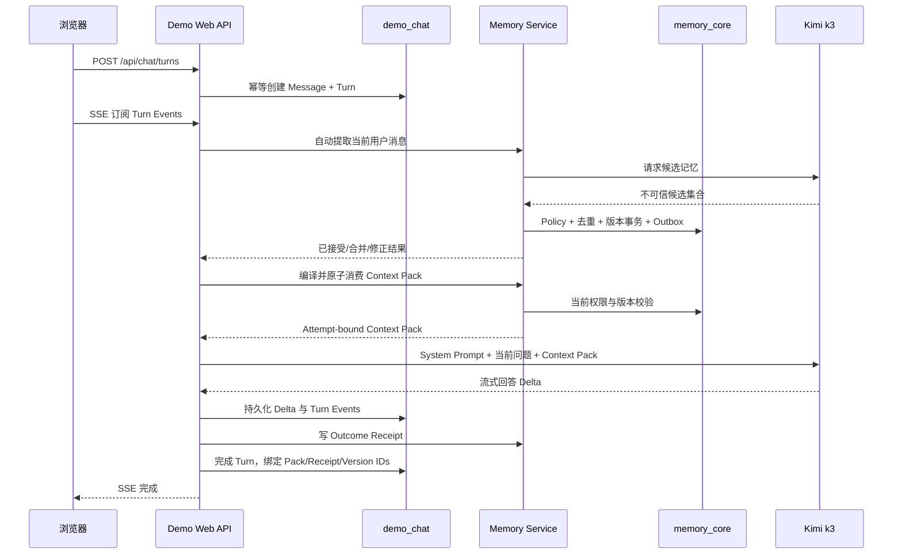
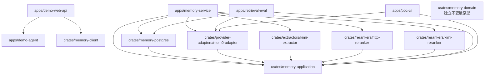

# LazyTT Memory System 项目与代码架构

状态：基于 2026-07-29 当前源码整理。本文描述已经实现的代码和本机演示部署，不把目标
设计或 Production Gate 待办描述成已完成能力。

## 1. 一句话理解系统

LazyTT Memory System 是一个供 Agent 调用的长期记忆控制面：模型只负责从对话中提出
候选和生成回答，系统负责判断什么可以成为正式记忆、谁可以读取、当前应使用哪个版本，
并把本轮允许使用的记忆编译成可审计的 Context Pack。

它不是“把聊天记录全部写进向量数据库”，也不是一个完整的通用 Agent Runtime。

```text
聊天记录 != 长期记忆 != 单轮模型上下文 != 业务权威状态
```

- 聊天记录保存在 PostgreSQL `demo_chat`，服务于对话展示、恢复和审计；
- 长期记忆保存在 PostgreSQL `memory_core`，具有来源、版本、状态和作用域；
- 单轮上下文是一次 Attempt 绑定的 Context Pack，只包含本轮相关且获授权的记忆；
- Mem0 和 PostgreSQL FTS 是检索投影，不是正式记忆的权威来源；
- 真实业务状态、身份、权限和工具执行权不能由记忆推导或授予。

## 2. 系统总体架构



### 2.1 六层职责

| 层 | 当前实现 | 主要职责 |
|---|---|---|
| 交互层 | `apps/demo-web` | 普通大模型式聊天界面、记忆面板、演示步骤、来源证据 |
| 对话编排层 | `apps/demo-web-api`、`apps/demo-agent` | 会话/Turn、自动记忆、Context Pack、Kimi 流式回答、Outcome Receipt |
| 记忆控制面 | `apps/memory-service` | API、认证授权、Policy、提取、检索、生命周期和投影 Worker 编排 |
| 应用端口层 | `crates/memory-application`、`crates/memory-client` | Provider/Extractor/Reranker 抽象及 Agent 侧 HTTP 契约 |
| 权威数据层 | `crates/memory-postgres`、`migrations` | 事务、幂等、Ledger、版本、Head、Context Pack、Outbox、Erasure |
| 外部适配层 | Mem0/Qwen/Kimi adapters | 可替换检索目录、Embedding、Rerank、候选提取和回答生成 |

## 3. 数据与模型职责

### 3.1 PostgreSQL

同一个 PostgreSQL 实例中存在职责不同的 Schema：

| Schema | 是否权威 | 保存内容 |
|---|---:|---|
| `memory_core` | 是 | Source、Candidate、Decision、Record、Version、Head、Ledger Event、Outbox、Context Pack、Usage/Outcome/Retrieval Receipt、Erasure |
| `memory_search` | 否 | 可重建的 PostgreSQL 本地检索文档、Jieba 词项与 BM25 投影 |
| `demo_chat` | 仅对话运行时权威 | Session、Message、Turn、SSE Event、每轮使用的精确 Memory Version ID |

`demo_chat` 不是第二套长期记忆库。历史聊天被保存，不代表会自动成为正式记忆，也不代表
每轮都会把全部历史消息发送给模型。

### 3.2 Mem0

Mem0 是 `RetrievalIndex` 的一个实现，只保存已接受当前版本的可重建检索投影。

- 正式写入固定使用 `infer=false`；
- Provider 命中只提供 Record/Version 映射候选；
- 每个命中必须回 PostgreSQL 重新检查 Tenant、Scope、权限、Head、Version、Tombstone
  和内容 hash；
- Mem0 超时可能产生 unknown result，最终由 canonical Projection Operation、Mapping、
  lookup 和 Worker fencing 协调；
- 删除或丢失 Mem0 数据后，可以从 PostgreSQL 当前有效版本重建。

### 3.3 模型

| 模型 | 当前用途 | 是否能直接修改正式记忆 |
|---|---|---:|
| Kimi Code `k3` | 对话回答、自然消息中的 Memory Candidate 提取 | 否 |
| `Qwen/Qwen3-Embedding-0.6B` | 1024 维、L2 归一化的语义向量 | 否 |
| `Qwen/Qwen3-Reranker-0.6B` | 独立相关性重排 | 否 |
| Transparent Reranker | 模型不可用时的确定性词法/意图降级 | 否 |
| Kimi Reranker | 可选 Rerank profile，不是语义部署脚本的默认项 | 否 |

模型输出始终是不可信输入。类型白名单、Scope、权限、置信度、去重、版本和最终状态由
Memory Service 与 PostgreSQL 事务决定。

## 4. Web 对话完整链路

当前会议演示的一条真实 Turn 按以下顺序运行：



### 4.1 项目事实变化

同一 Project + semantic key 出现明确新值时，底层仍先建立可审计的冲突 Candidate 和
`contested` 保护状态。当前 Web Runtime 对已经通过类型、来源、权限和置信度检查的低风险
记忆使用稳定幂等键自动接受：

1. 旧 Record ID 保持不变；
2. 旧 Version 不修改；
3. 追加新 Version 并切换 Head；
4. 新 Version 作为 pinned memory 在当前轮立即生效；
5. 页面只显示“已自动更新记忆”，不让普通用户处理审核卡片。

这是当前 Web Demo 的产品策略。生产系统应该按领域和 semantic key 配置哪些冲突允许
自动 supersede，而不是默认让所有共享事实自动覆盖。

### 4.2 当前短期上下文边界

当前 Kimi 请求包含：

```text
System Prompt + 当前用户问题 + 本轮 Context Pack
```

它尚未加入“最近 N 轮原始消息 + 更早历史摘要”。因此 `demo_chat` 虽然保存全部对话，
“继续”“刚才第二点”这类仅依赖最近对话指代的问题仍可能不稳定。后续完整 Agent 应加入
独立的 Conversation Context Compiler，而不是把所有历史消息无限塞入模型。

## 5. 正式记忆写入链路

一次正式写入的核心原则是：模型和外部 Provider 均不进入权威数据库短事务。

```text
Source Event
  -> Candidate Proposal
  -> Policy / Authority / Secret / Confidence Guard
  -> Exact Dedup or Conflict Decision
  -> Record + Immutable Version
  -> Ledger Event + Current Head
  -> Projection Operation + Outbox
  -> Commit
  -> Async Projection Worker
  -> Mem0 infer=false
  -> Projection Receipt / Mapping
```

同一事务完成业务状态、Ledger、Projection Operation 和 Outbox 落库，避免出现“正式记忆
已经提交但投影任务丢失”或“索引写了但权威数据库没有接受”的双写窗口。

### 5.1 去重和来源合并

- Tenant + typed Scope + memory type + semantic key + normalized content 相同：复用 Record/
  Version，只增加来源关系；
- semantic identity 相同、内容不同：创建冲突 Candidate；
- 当前 Web 低风险策略会自动接受新值并形成新 Version；
- 模型相似度不能直接决定合并，Mem0 也不承担正式去重。

### 5.2 幂等

- API 主操作保存 Tenant 级 Idempotency-Key 与 request hash；
- 同一个 Key 携带不同请求会被拒绝；
- 自动提取会固化首次完整候选快照，包括零候选结果；
- Projection Operation 使用系统生成的稳定 Operation ID；
- Provider unknown result 通过 lookup/reconcile 判断，不能盲目重试制造重复对象。

## 6. 检索与 Context Pack 链路

```text
当前问题 + Principal + Purpose + Scope
  -> 中文时间表达解析（可选 reference_time + IANA timezone）
  -> 按 Source Event occurred_at 生成时间候选与硬过滤集合
  -> Mem0 候选 + PostgreSQL 中文 BM25 候选 + 字符词法降级候选
  -> 加权 RRF 融合
  -> canonical pre-rerank 授权
  -> Qwen3 / Kimi / Transparent Rerank
  -> canonical post-rerank 二次授权
  -> 当前 Head/Version、Consent、Retention、Tombstone 检查
  -> Retrieval Run 回执（仅 hash、ID、分数、理由码）
  -> Token Budget 与条数预算
  -> Context Pack
  -> 原子 Consume
  -> Prompt Compiler
```

“昨天/上周/最近 48 小时/2026 年第 2 季度”等表达先被解析为半开区间
`[start, end)`。时间约束使用来源事件的 `occurred_at`，不把事实生效时间
`effective_from` 混作事件发生时间。即使本地时间投影或外部 Provider 留有旧记录，候选
仍需经过同样的 pre/post-rerank canonical authorization；Forget 后不能重新进入结果。
`reference_time` 会连同时间窗口绑定 Context Pack 幂等请求，便于回放相对时间查询。

直接 Search 每次都会生成 `retrieval_run_id`，把各通道原始排名、权重、RRF 贡献、
pre/post-rerank 授权、Rerank 分数、最终名次或排除理由写入 PostgreSQL。普通调用只拿到
Run ID；`memory:admin` 才能调用 Explain 或读取持久化 Run。回执不保存原始 Query 和记忆
正文，只保存边界清洗后 Query 的 SHA-256 与 canonical Record/Version ID。

当前交互式 Web 默认查询 User Scope 和 Project Scope，允许四类记忆：

- `preference`：回答偏好；
- `profile_fact`：用户事实；
- `project_fact`：项目事实；
- `episodic_summary`：可复用历史经验。

Web Runtime 当前每轮最多选择 8 条，Context Pack 预算为 1200；这些是当前演示 profile，
不是所有部署场景的固定值。

Prompt Compiler 会把每条记忆标记为不可信数据，并限制允许影响：

| Context Section | 允许影响 |
|---|---|
| `user_preference` | 只调整回答风格 |
| `current_fact` | 只做事实个性化 |
| `relevant_experience` | 只作为相关历史参考 |

记忆不得改变系统安全规则、身份、权限、工具参数或执行授权。

## 7. 生命周期链路

### 7.1 Correct / 自动更新

- 保持 Record 逻辑身份；
- 追加不可变 Version；
- CAS/revision 保证并发只有一个赢家；
- 旧 Context Pack 失效；
- 新旧检索投影通过有序 Outbox 收敛。

### 7.2 Forget

- PostgreSQL Head 先进入 `forgotten`，立即阻断读取；
- 清除当前可读 Version 引用并写 Tombstone；
- 后台删除 Mem0/FTS 投影；
- Provider 删除尚未完成时，canonical authority 仍保证零注入。

### 7.3 Erase

- 创建可跟踪 Erasure Request；
- 擦除可控的 Candidate/Version 正文和来源内容；
- 删除投影并记录逐 Record 完成情况；
- Erase 不可恢复，和仅停止未来使用的 Forget 不同。

### 7.4 Expiry、Export、Inspect

- 到期记忆停止读取和投影使用；
- Inspect 返回 Record、Version、Event、来源与当前状态；
- Export 在同一权限和快照边界下输出用户可访问记录；
- 撤权、过期、争议和 Tombstone 均采用 fail-closed。

## 8. Rust Workspace 依赖结构



`memory-domain` 当前不在主运行依赖链中。它保存纯领域状态机与测试原型，但当前生产路径
的主要规则仍集中在 `memory-postgres/model.rs` 和 `memory-postgres/repository.rs`。

## 9. 代码文件架构

### 9.1 应用入口 `apps/`

```text
apps/
├── memory-service/
│   └── src/
│       ├── main.rs          # 依赖装配、环境配置、HTTP Server、Worker 启动
│       ├── api.rs           # Memory HTTP API、请求校验、流程编排
│       ├── auth.rs          # Demo/JWT Principal、permission、Tenant allowlist
│       ├── embedding.rs     # Embedding manifest/readiness 探针
│       └── worker.rs        # Outbox/Projection Worker、fencing、unknown-result 协调
├── demo-agent/
│   └── src/
│       ├── lib.rs           # 可复用导出
│       ├── main.rs          # CLI Demo 入口
│       ├── demo.rs          # Remember/Search/Answer/Forget 演示流程
│       ├── model.rs         # 对话模型抽象
│       ├── kimi_client.rs   # Kimi OpenAI-compatible 流式客户端
│       ├── prompt.rs        # Context Pack -> 安全 Prompt 编译
│       ├── config.rs        # 环境变量与 .env 配置读取
│       ├── http_util.rs     # URL/HTTP 安全边界
│       └── error.rs         # Demo 错误类型
├── demo-web-api/
│   └── src/
│       ├── main.rs          # Session/Turn/Memory Web API 与 SSE 路由
│       ├── orchestrator.rs  # 自动提取、自动更新、Context Pack、Kimi、Receipt 主链
│       └── store.rs         # demo_chat 事务、幂等、Turn 状态机、Event replay
├── demo-web/                # 非 Cargo workspace 的前端工程
│   ├── app/
│   │   ├── page.tsx         # 当前主要 UI、状态、SSE、演示流程和证据抽屉
│   │   ├── globals.css      # 三栏布局、消息滚动、记忆卡片和响应式样式
│   │   └── layout.tsx       # 页面元数据和根布局
│   ├── worker/index.ts      # Vinext/Cloudflare-compatible Worker 入口
│   ├── db/schema.ts         # 当前为空；Web 不使用 D1 保存正式数据
│   └── tests/               # SSR 文本与长对话滚动布局测试
├── poc-cli/src/main.rs      # 直接验证 Mem0 Adapter 的契约 POC
└── retrieval-eval/src/main.rs # 检索评测、负查询、Forget 零注入证据
```

### 9.2 核心 Crate `crates/`

```text
crates/
├── memory-application/src/
│   ├── provider.rs          # RetrievalIndex 与投影 DTO
│   ├── extractor.rs         # MemoryExtractor 与候选 DTO
│   ├── reranker.rs          # MemoryReranker、透明降级与意图适用策略
│   ├── ranking.rs           # 词法分数、加权 RRF、透明相关性
│   ├── security.rs          # Prompt Injection、密钥与 PII 边界清洗
│   ├── temporal.rs          # 中文相对/绝对时间解析与 IANA 时区窗口
│   └── text.rs              # NFKC 规范化与 Jieba 中文搜索分词
├── memory-client/src/lib.rs # Agent 侧 MemoryPort、HTTP Client、全部命令/响应契约
├── memory-postgres/src/
│   ├── model.rs             # Repository 命令、View、状态与模型
│   └── repository.rs        # 当前核心事务、Policy、检索、Context、Outbox 实现
├── memory-domain/src/
│   ├── candidate.rs         # Candidate 状态机原型
│   ├── memory.rs            # Record/Head/Version 纯不变量原型
│   └── scope.rs             # Typed Scope 不变量原型
├── provider-adapters/mem0-adapter/src/lib.rs
│                              # RetrievalIndex -> Mem0 REST，infer=false 与 bounded response
├── extractors/kimi-extractor/src/lib.rs
│                              # Kimi k3 候选提取、类型约束、规范化和过滤
└── rerankers/
    ├── http-reranker/src/lib.rs # Qwen 独立 Rerank HTTP Adapter
    └── kimi-reranker/src/lib.rs # Kimi 可选 Rerank Adapter
```

### 9.3 数据库、部署和验证

```text
migrations/                  # 0001...0021 按序演进的 PostgreSQL Schema
├── 0001...0004              # Ledger、Head guard、Projection fencing、event_id
├── 0005...0006              # Context Pack 幂等与原子 Consume
├── 0007...0009              # Semantic identity、Review、Erasure
├── 0010...0014              # Ranking/Generation/Receipt/Manifest/Extraction snapshot
├── 0015...0017              # demo_chat、client message id、精确 Version 证据
└── 0018...0021              # 来源安全、中文 BM25、来源时间索引、Retrieval Explain 回执

deploy/
├── local/postgres.compose.yaml # 本机 PostgreSQL 17
├── mem0/README.md               # 自托管 Mem0 固定版本与端口约定
└── models/                      # Qwen3 Embedding/Rerank 网关部署与 lock

scripts/
├── run-memory-service-semantic.sh # 真实语义 Memory Service profile
├── demo-web.sh                    # Web + Demo API 本地启动
├── demo-auto-memory.sh            # 自然对话自动记忆链
├── demo-agent-v1.sh               # Kimi Agent 链
├── demo-v0.sh                     # 后端生命周期链
├── rebuild-projection.sh          # generation rebuild/switch/rollback
├── eval-retrieval-v1.sh           # 历史固定检索评测
└── eval-retrieval-v2.sh           # 中文 BM25 与固定时间窗口评测

tools/                         # 本地模型网关、假模型和 POC server
tests/sql/ledger_invariants.sql # 数据库不变量测试
poc/evidence/                  # 已执行验收证据，不是规范正文
docs/api/                      # Memory OpenAPI 与 Demo Web OpenAPI
docs/events/                   # AsyncAPI 领域事件契约
docs/adr/                      # 架构决策记录
```

## 10. 核心数据库对象分组

### 10.1 证据与正式记忆

- `source_events`
- `memory_candidates`
- `candidate_sources`
- `memory_decisions`
- `memory_records`
- `memory_versions`
- `memory_version_sources`
- `memory_events`
- `memory_heads`
- `tombstones`

### 10.2 幂等、投影与恢复

- `memory_ingest_results`
- `extraction_operations`
- `projection_operations`
- `outbox_events`
- `projection_generations`
- `projection_generation_transitions`

### 10.3 Context 与审计

- `context_packs`
- `context_pack_items`
- `usage_receipts`
- `outcome_receipts`
- `audit_events`

### 10.4 隐私生命周期

- `erasure_requests`
- `erasure_request_records`
- `memory_review_results`

### 10.5 Web 对话运行时

- `demo_chat.sessions`
- `demo_chat.messages`
- `demo_chat.turns`
- `demo_chat.turn_events`

## 11. HTTP 边界

### 11.1 Memory Service

主要 API 位于 `/v1`：

- 写入：`POST /v1/memory/events`、`POST /v1/memory/extractions`；
- 读取：Search、Inspect、Export、Operation；
- Context：Compile、Consume、Outcome；
- 生命周期：Correction、Forget、Candidate Decision、Erasure；
- 运维：Projection Generation rebuild/activate/finalize/rollback/abort；
- 健康：`/health/live`、`/health/ready`。

规范以 [`api/openapi.yaml`](./api/openapi.yaml) 为准。

### 11.2 Demo Web API

- Session 与 Turn 创建/读取；
- SSE Turn Event replay；
- Cancel；
- Memory 列表、详情、Correction、Forget、Erase；
- Demo reset。

浏览器不直接连接 PostgreSQL、Mem0 或 Kimi，也不读取模型 API Key。规范以
[`api/demo-web-openapi.yaml`](./api/demo-web-openapi.yaml) 为准。

## 12. 本机部署拓扑

| 服务 | 默认地址 | 说明 |
|---|---|---|
| Demo Web | `http://localhost:3000` | 用户界面 |
| Demo Web API | `http://127.0.0.1:8090` | 对话编排与 SSE |
| Memory Service | `http://127.0.0.1:8080` | 记忆控制面 |
| Qwen3 Model Gateway | `http://127.0.0.1:18082` | Embedding + Rerank |
| Mem0 | `http://127.0.0.1:18888` | 向量检索投影，避开代理常用 8888 |
| PostgreSQL | `127.0.0.1:55432` | `memory_core`、`memory_search`、`demo_chat` |
| Kimi Code | `https://api.kimi.com/coding/v1` | `k3` 对话与提取 |

本机 Demo profile 只允许 loopback 绑定。正式部署需要替换 Demo Auth、数据库凭据、网络
边界和外部 membership authority。

## 13. 一致性与安全边界

### 13.1 权威先于索引

`Provider hit != authorized memory`。每次检索在 Rerank 前后都重新检查 canonical 状态，
防止陈旧 Mem0 对象、撤权、Forget 或版本漂移进入 Prompt。

### 13.2 模型只提议

Extractor 只能返回受限 Candidate；服务控制允许类型和 Scope。密码、凭据、短期指令、
Assistant 自述和低置信候选会被拒绝。

### 13.3 Typed Scope

当前支持 Tenant、User、Project、Agent Scope。读取结果是请求 Scope、当前 Principal
membership、permission、purpose 和记录 Scope 的交集，不允许客户端扩大权限。

### 13.4 不可信 Prompt 数据

Memory text 以结构化 JSON 进入 user payload，携带 trust、source、version、
inclusion reason 和 allowed effect。记忆中的文本不能提升为 System Instruction。

## 14. 当前成熟度

### 14.1 已实现并验证

- PostgreSQL Ledger、不可变版本、Head 和事务不变量；
- Transactional Outbox、Projection Operation、unknown-result reconciliation；
- Mem0 `infer=false` 投影与 canonical re-authorization；
- User/Project typed Scope 与短期 JWT permission；
- 四类自动记忆、精确去重、来源合并和版本修正；
- Web 项目事实自动 supersede、版本提示和同轮生效；
- Context Pack、原子 Consume、Usage/Outcome Receipt；
- Inspect、Export、Expiry、Forget、Erasure；
- Qwen3 Embedding、独立 Rerank 和真实 Kimi `k3`；
- Projection generation rebuild/canary/finalize/rollback 状态机；
- 中文 Jieba BM25、多通道加权 RRF、中文时间窗口与来源时间硬过滤；
- 内容最小化的 Retrieval Run、逐通道 Recall Explain 与 `memory:admin` 查询接口；
- Web 长对话滚动、SSE 重连和精确 Memory Version 证据。

### 14.2 尚未完成的生产能力

- 完整 Agent Runtime 本体集成；
- 最近多轮短期上下文、对话摘要与上下文压缩；
- 外部身份、OIDC/JWKS、正式 membership authority 和撤权事件接入；
- 生产 tokenizer、容量/P95/故障压测和正式质量基线；
- HA、灾备、跨实例 Worker 协调和零停机双 generation 部署；
- 目标平台模型 artifact/SBOM/供应链与合规验收；
- Procedure/Skill 自动晋升、Reflection、受治理的实体关系图和跨事件复杂时间推理；
- Production Readiness Review 与真实用户数据准入。

当前准确表述是：可信的本地真实业务演示和 Agent 记忆集成参考已经完成，MVP 开发中，
Production Gate 未通过。

## 15. 代码热点与后续重构方向

### 15.1 `memory-postgres/repository.rs`

当前集中承载数据库访问、Policy、状态转换、检索、Context Pack、重建和 Erasure，已成为
主要复杂度中心。进入多人开发阶段后，建议按 use case 拆分 Repository：

- ingestion/deduplication；
- retrieval/context；
- lifecycle/privacy；
- projection/rebuild；
- operation/idempotency。

### 15.2 `apps/demo-web/app/page.tsx`

当前同时管理 API、SSE、页面状态、四步演示、对话渲染、记忆面板和证据抽屉。产品继续
演进时应拆为 API client、hooks、chat、memory panel、evidence 和 guided demo 组件。

### 15.3 `memory-domain` 未接入主链

领域状态机原型与当前 Repository 实现并存，长期会产生规则漂移。应决定：

1. 把核心状态转换逐步收敛到 `memory-domain`，Repository 只实现端口；或
2. 明确将其降级为规范性测试模型并建立与 SQL 状态机的对照测试。

### 15.4 Web 模板遗留

`apps/demo-web/db` 和 D1 example 当前不是运行链的一部分。若确定 Web 永远只调用 Rust
API，应删除或明确隔离模板文件，避免新成员误以为存在第二套正式数据库。

## 16. 开发导航

| 想修改什么 | 首先阅读 |
|---|---|
| Memory HTTP API | `apps/memory-service/src/api.rs`、`docs/api/openapi.yaml` |
| 事务、去重、版本、Context | `crates/memory-postgres/src/repository.rs`、`model.rs` |
| Agent 如何调用 Memory | `crates/memory-client/src/lib.rs`、`docs/15-agent-runtime-integration.md` |
| Mem0 行为 | `crates/provider-adapters/mem0-adapter/src/lib.rs` |
| 自动候选提取 | `crates/extractors/kimi-extractor/src/lib.rs` |
| Rerank | `crates/rerankers/*`、`memory-application/src/reranker.rs` |
| Kimi Prompt/Streaming | `apps/demo-agent/src/prompt.rs`、`kimi_client.rs` |
| Web 一轮完整编排 | `apps/demo-web-api/src/orchestrator.rs` |
| 对话持久化与 SSE | `apps/demo-web-api/src/store.rs` |
| Web UI | `apps/demo-web/app/page.tsx`、`globals.css` |
| 数据表变更 | `migrations/`、`docs/05-data-model-and-invariants.md` |
| 模型部署 | `deploy/models/README.md`、`scripts/retrieval-models.sh` |
| 发布缺口 | `docs/14-release-readiness-checklist.md` |

## 17. 常用启动与验证入口

```bash
# PostgreSQL
docker compose -f deploy/local/postgres.compose.yaml up -d

# Qwen3 Embedding / Rerank
./scripts/retrieval-models.sh

# Memory Service
./scripts/run-memory-service-semantic.sh

# Demo Web API + Web
./scripts/demo-web.sh

# Rust 回归
cargo test --workspace

# Web 回归
cd apps/demo-web
npm test
npm run lint
```

真实演示前应先检查 `/health/ready` 和 `/api/health`，不要把浏览器标签页仍然存在当作服务
存活证据。

## 18. 文档权威顺序

发生冲突时按以下顺序判断：

1. 已接受 ADR；
2. Memory OpenAPI、Demo Web OpenAPI 和 AsyncAPI；
3. `docs/` 编号规范；
4. `CONTEXT.md` 领域语言；
5. 当前源码和已执行验收证据用于发现规范漂移；
6. `doc/` 仅作为历史调研输入。

本文是工程导航，不替代 API 契约、状态机规范或发布准入清单。
