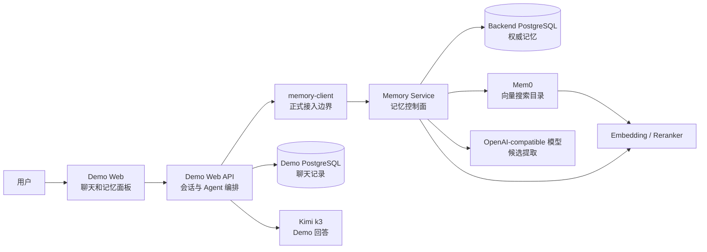
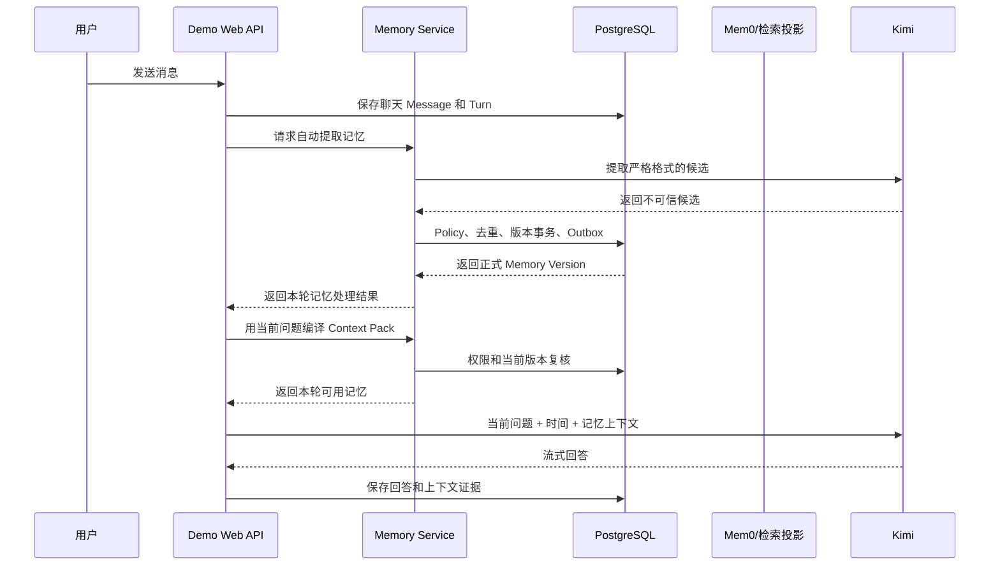

# 如何理解当前 LazyTT 记忆系统架构

状态：通俗理解版，基于 2026-07-31 当前源码和本地部署整理。

本文不是代码文件清单，而是帮助第一次接触项目的人建立正确的整体认识。详细实现见
[项目与代码架构](./18-project-and-code-architecture.md)。

## 1. 先记住一句话

LazyTT Memory System 是一个供 Agent 调用的长期记忆后端。

模型负责理解语言和生成候选，记忆系统负责决定：

- 什么可以成为正式记忆；
- 这条记忆属于谁；
- 当前哪个版本有效；
- 这次回答允许使用哪些记忆；
- 用户要求忘记后，怎样保证旧内容不再出现。

可以把它理解成：

```text
PostgreSQL 权威档案 + 可重建搜索目录 + 单轮上下文编译器
```

## 2. 最重要的四个概念

理解这个项目之前，必须先把下面四件事分开。

| 概念 | 简单理解 | 当前保存位置 |
| --- | --- | --- |
| 聊天记录 | 用户和 Agent 原始说过的话 | Demo PostgreSQL `demo_chat` |
| 长期记忆 | 经过治理、可跨对话复用的信息 | 后端 PostgreSQL `memory_core` |
| 单轮上下文 | 当前这一轮实际交给模型的材料 | Context Pack + Prompt Snapshot |
| 业务权威状态 | 真实订单、权限、项目成员关系等 | 外部业务系统，不由记忆系统决定 |

### 一个容易犯的错误

```text
聊天里说过 ≠ 已经成为长期记忆
搜索命中 ≠ 当前有权读取
历史记忆存在 ≠ 本轮一定会交给模型
模型说是真的 ≠ 业务系统已经确认
```

当前 Demo 会保存完整聊天用于页面恢复和审计，但不会把全部历史聊天都塞给模型。模型当前
主要收到：当前问题、服务器时间和本轮筛选出的长期记忆。最近若干轮短期会话窗口仍是下一
阶段功能。

## 3. 用三个生活比喻理解

### PostgreSQL 是正式档案室

正式记忆、来源、版本、当前状态、删除记录和审计事件都保存在 PostgreSQL。

档案室决定“什么是正式记录”，其他组件不能绕过它直接改结果。

### Mem0、BM25 和时间索引是目录

目录帮助快速找到可能相关的档案，但目录本身不是档案。

即使搜索目录里还残留旧条目，系统也必须回 PostgreSQL 检查当前版本、权限和 Forget 状态。

### Context Pack 是本轮开卷资料包

每次 Agent 回答问题前，Memory Service 都会为这一轮准备一个资料包，只放入：

- 当前问题相关的内容；
- 当前用户有权读取的内容；
- 当前版本仍然有效的内容；
- 没有超过条数和 token 预算的内容。

这个资料包绑定本轮 Task/Attempt，用完后留下证据，不能拿到另一轮偷偷复用。

## 4. 总体架构



### 各部分负责什么

| 部分 | 负责 | 不负责 |
| --- | --- | --- |
| Demo Web | 页面、用户切换、记忆和证据展示 | 不直接访问数据库和 Memory JWT |
| Demo Web API | Session、Turn、流式回答、调用 Memory Service | 不直接修改 `memory_core` |
| `memory-client` | 给 Agent 提供稳定的 Memory API/Port | 不决定记忆 Policy |
| Memory Service | 认证、治理、写入、检索、生命周期、Context Pack | 不负责完整通用 Agent Runtime |
| Backend PostgreSQL | 正式版本、Head、Ledger、Outbox、回执 | 不负责语言理解 |
| Mem0 | 语义检索候选 | 不是正式记忆来源 |
| Qwen3 模型 | Embedding 和 Rerank | 不能修改正式状态 |
| Kimi | 提出候选、生成回答 | 不能自行扩大 Scope 或授权 |

## 5. 一条用户消息是怎样运行的

假设用户输入：

```text
我在 2026 年 7 月 15 日处理过 Outbox 重复消费，最后用 event_id 去重解决了。
```

系统按下面的顺序执行：



这里有两个关键点：

1. Kimi 只提出候选，PostgreSQL 事务决定它是否成为正式记忆；
2. 本轮回答使用的是 Context Pack，不是把整个记忆库直接发给模型。

## 6. 正式记忆是怎样写入的

正式写入链路可以简化为：

```text
Source Event
  → Memory Candidate
  → 安全与类型检查
  → Scope 与权限检查
  → 精确去重或冲突判断
  → Memory Record + Immutable Version
  → Ledger Event + Current Head
  → Projection Operation + Outbox
  → 异步更新 Mem0 / BM25 投影
```

### 为什么要这么复杂

如果直接让模型把文本写进向量数据库，会遇到：

- 同一句话重复保存很多次；
- 模型把猜测当成事实；
- 项目记忆泄露给无关用户；
- 事实更新后不知道哪个版本有效；
- 用户要求删除后，旧向量仍然能被搜到；
- 数据库写入成功但索引更新失败，或者反过来。

当前架构用 PostgreSQL 事务和 Outbox 解决“权威数据与检索投影不同步”的问题。

## 7. 记忆是怎样被找出来的

读取时不是只做一次向量搜索，而是走多路召回：

```text
当前问题
  → 解析时间范围（如果有）
  → Mem0 语义候选
  → PostgreSQL 中文 BM25 候选
  → 本地词法候选
  → Event Time 时间候选
  → 加权 RRF 融合
  → Reranker 重排
  → PostgreSQL 权限和当前版本复核
  → 条数与 token 预算
  → Context Pack
```

这样设计的原因是：

- 向量检索擅长“意思相近”；
- BM25 擅长关键词和技术名词；
- 词法检索提供确定性降级；
- 时间检索解决“昨天、前天、7 月份做过什么”；
- Reranker 负责对候选再次排序；
- PostgreSQL 最后负责判断“能不能用”。

## 8. 四类记忆和四种范围

### 记忆类型回答“它是什么”

| 类型 | 例子 | 允许怎样影响回答 |
| --- | --- | --- |
| `preference` | 用户喜欢先看结论 | 只调整回答方式 |
| `profile_fact` | 用户是 Agent 工程师 | 只做个人背景补充 |
| `semantic_fact` | 项目使用 PostgreSQL | 只做事实个性化 |
| `episodic_summary` | 曾解决 Outbox 重复消费 | 只作为相关历史经验 |

### Scope 回答“谁可以看到”

```text
user    个人范围
project 项目范围
tenant  租户范围
agent   指定 Agent 范围
```

类型和范围是两个维度。例如，`semantic_fact` 可以是个人事实，也可以是项目事实，不能通过
类型名称直接推导访问权限。

## 9. 版本、修正、忘记和清除

### 修正不是覆盖

事实发生变化时，系统追加新 Version，并把 Head 指向新版本。旧版本保留用于审计。

```text
Record: project.authority_database
  v1 PostgreSQL
  v2 CockroachDB  ← 当前 Head
```

### Forget 和 Erase 不一样

| 操作 | 含义 |
| --- | --- |
| Forget | 立即停止读取，但保留必要的版本和审计信息 |
| Erase | 物理擦除允许删除的正文，通常不可恢复 |

Forget 先改变 PostgreSQL 权威状态，因此不需要等待 Mem0 删除完成才能阻止旧内容进入回答。

## 10. Context Pack 为什么是架构核心

Context Pack 解决“记忆库里有很多内容，但这一轮模型到底看到了什么”的问题。

它绑定：

- `task_id` 和 `attempt_id`；
- 当前问题和用途；
- 用户、项目和权限快照；
- 服务器当前时间和时区；
- 记忆 Record/Version；
- 检索、排序和投影版本；
- token 预算和选入理由。

Demo Web API 会把同一份 Prompt Context Snapshot：

```text
一份传给模型
一份保存到 demo_chat.turns
```

证据面板读取保存的快照，因此不会在回答结束后重新搜索一遍，再用新结果冒充当时的模型
输入。

需要注意：当前证据面板展示的是模型 User Payload 中的运行时上下文和记忆上下文，不包括
模型隐藏推理，也不是完整 HTTP 请求抓包。

## 11. 三套数据分别归谁管理

| 数据 | 权威位置 | 能否重建 |
| --- | --- | ---: |
| 正式 Memory Record/Version/Head | Backend PostgreSQL `memory_core` | 否，它本身就是权威 |
| 本地 BM25/词法检索文档 | Backend PostgreSQL `memory_search` | 可以 |
| Mem0 向量对象 | Mem0 + pgvector | 可以 |
| Demo Session/Message/Turn | Demo PostgreSQL `demo_chat` | 不能从长期记忆完整恢复 |
| Context Pack/Receipt | Backend PostgreSQL | 属于审计证据 |
| Prompt Context Snapshot | Demo PostgreSQL | 属于本轮模型输入证据 |

因此：

- 删除 Mem0 不等于删除正式记忆，可以从 PostgreSQL 重建；
- 删除聊天记录不等于 Forget 长期记忆；
- Forget 长期记忆也不会自动抹掉所有原始聊天，二者是不同的数据生命周期。

## 12. 当前部署怎么理解

正式边界已经拆成两个仓库：

```text
lazytt-frontend-console       可选 Demo
  ├─ Web :3000
  ├─ Demo Web API :8090
  └─ Demo PostgreSQL
            │
            │ memory-client + JWT
            ▼
lazytt-memory-system         可独立使用的后端
  ├─ Memory Service :8080
  ├─ PostgreSQL :55432
  ├─ Mem0 :18888
  └─ Embedding / Reranker
```

只给正式 Agent 使用时，只需要部署后端仓库。需要开会演示或人工测试时，再部署前端仓库。

后端提供四种本地 Profile：

| Profile | 模型位置 | 适合场景 |
| --- | --- | --- |
| `cloud` | 硅基流动 | 新机器快速测试 |
| `cpu` | Docker CPU | 完全本地、功能验证 |
| `cuda` | Linux NVIDIA | GPU 服务器 |
| `host-mps` | Mac 宿主机 MPS | Apple Silicon 加速 |

## 13. 代码目录怎么对应架构

```text
lazytt-memory-system/
├─ apps/
│  └─ memory-service/        对外 HTTP 服务和运行编排
├─ crates/
│  ├─ memory-domain/         领域对象和基础不变量
│  ├─ memory-application/    检索融合、安全、时间、Port
│  ├─ memory-client/         正式 Agent 接入 SDK
│  ├─ memory-postgres/       权威 Repository 和事务
│  ├─ provider-adapters/     Mem0 适配器
│  ├─ extractors/            候选提取模型适配器
│  └─ rerankers/             Reranker 适配器
├─ migrations/               PostgreSQL 追加式 Migration
├─ deploy/                   PostgreSQL、Mem0、模型部署
├─ scripts/                  启动、演示、评测、重建脚本
├─ docs/                     当前规范性文档
└─ poc/evidence/             本地验收证据
```

独立 Demo 仓库可以理解为：

```text
lazytt-frontend-console/
├─ app/                      Next.js 页面
├─ components/               记忆卡片和证据面板
├─ services/demo-web-api/    会话与 Turn 编排
├─ services/demo-agent/      Prompt 和 Kimi Client
└─ vendor/memory-client/     与后端契约同步的 SDK
```

## 14. 当前已经完成什么

- 四类长期记忆；
- User/Project/Tenant/Agent Scope；
- 自动候选提取；
- 去重、来源合并、冲突和 Review；
- 不可变版本和当前 Head；
- Embedding、BM25、词法、时间多路召回；
- RRF 和独立 Reranker；
- Context Pack 和多种 Receipt；
- Correction、Forget、Erase、Expiry、Export；
- 多用户和项目共享 Demo；
- 前后端分仓和 Docker 下载运行。

## 15. 当前还缺什么

- 最近若干轮的短期会话上下文；
- 会话滚动摘要和长对话压缩；
- 正式 LazyTT Agent Runtime 集成；
- OIDC/JWKS 和外部 Membership Authority；
- 生产 TLS、Secret Manager、固定发布镜像；
- 大规模质量、延迟、容量和成本评测；
- 监控告警、HA、Backup/PITR 和灾备演练；
- 完整 Production Readiness Review。

所以当前最准确的成熟度描述是：

> 核心长期记忆闭环和本地真实演示已经完成，可以供他人下载测试；正式 Agent 接入和生产化
> 能力仍在建设中。

## 16. 推荐的理解顺序

第一次接触项目时，不建议先逐个看文件。推荐顺序是：

1. 启动后端和 Web Demo；
2. 跟踪一条“自然对话 → 形成记忆 → 新对话召回”的真实请求；
3. 在右侧检查类型、Scope、版本、Event Time 和证据；
4. 执行一次事实更新，观察 v1/v2 和 Head；
5. 执行一次 Forget，确认 PostgreSQL 先阻断、投影随后收敛；
6. 再回到代码，从 `apps/memory-service` 进入 Repository 和 Adapter。

## 17. 用五个问题检查是否理解

读完本文后，能够回答下面五个问题，就基本理解了当前架构：

1. 为什么 Mem0 搜索到一条内容，不代表 Agent 一定能使用它？
2. 为什么修正事实要新增 Version，而不是直接修改旧正文？
3. 为什么 Forget 不需要等待向量数据库删除完成才能阻止读取？
4. 为什么聊天记录、长期记忆和 Context Pack 必须分开？
5. 为什么正式 Agent 只需要接入 `memory-client`，不应该直接读取 PostgreSQL Schema？

## 18. 继续阅读

- [记忆系统会议介绍](./23-memory-system-meeting-overview.md)
- [项目与代码架构](./18-project-and-code-architecture.md)
- [系统架构与信任边界](./02-architecture-and-trust-boundaries.md)
- [写入、读取、修正和遗忘流程](./04-write-read-correct-forget-flows.md)
- [Context Pack 契约](./07-context-pack-contract.md)
- [后端与 Demo 拆仓边界](./21-repository-split-and-local-integration.md)
- [后端 Docker 部署](./22-backend-docker-deployment.md)
