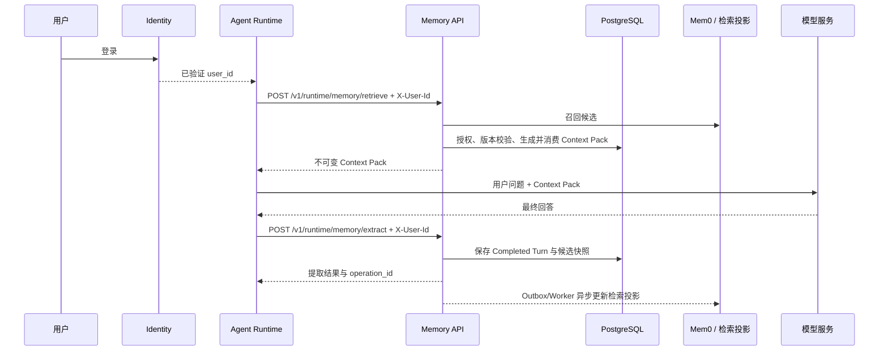

# Identity 与 Agent Runtime 接入说明（P0）

## 1. 一句话理解

Identity 系统负责确认“这个人是谁”，Agent Runtime 负责组织一次 Agent Loop，Memory
System 只接收已经验证过的 `X-User-Id`，按用户隔离地读取和形成长期记忆。

P0 的默认边界是：固定租户 `lazytt-default`、受信任内网、无登录页面、无 Token、只开放
用户级读取与提取。公网和跨信任域仍必须使用 JWT。

## 2. 功能模块与交互链路



| 模块 | 当前职责 | 不负责什么 |
|---|---|---|
| Identity 适配 | 从请求读取一个 `X-User-Id`，建立用户级 authority | 不提供登录、密码或会话管理 |
| Runtime Facade | 用简单接口完成“召回快照”和“每轮提取” | 不允许调用方指定 tenant/project/agent scope |
| Context Pack | 授权、排序、预算裁剪、形成不可变快照 | 不把记忆当作可执行指令 |
| Completed Turn | 保存可见用户输入、最终回答、已验证工具结果和 Outcome | 不保存隐藏推理 |
| Policy / Ledger | 分类、去重、版本、审计、遗忘与擦除状态 | 不把向量库当权威数据源 |
| Projection Worker | 用 Outbox 将权威版本同步到检索投影 | 不改变权威 Head |
| Consolidation Worker | 每十个未汇总 Turn 或显式触发时提炼 Episode 经验 | 不代替每轮提取 |

## 3. Auth 如何拆分

### 已实现

- `MEMORY_AUTH_MODE=trusted_user_id`：Memory Service 不登录、不验 Token，只接收一个
  `X-User-Id`；
- `MEMORY_DEFAULT_TENANT_ID=lazytt-default`：P0 固定租户，不允许请求传入 tenant；
- 每个请求在服务端生成 `DemoAuthority::user(tenant_id, user_id)`，数据库查询和写入都以
  这个 authority 作为隔离条件；
- 该身份只拥有 `memory:read`、`memory:extract`、`memory:outcome`；没有写项目记忆、
  导出、纠正、遗忘、擦除或管理权限；
- 缺失、重复、前后带空格、含控制字符或超过 256 字符的 `X-User-Id` 都会拒绝。

### 边界

`trusted_user_id` 是“信任上游已认证结果”，不是 Memory Service 自己完成认证。因此它
只能部署在隔离的受信任网络，由 OS Kernel/API Gateway 清除外部同名 Header 后重新写入。
公网、跨团队或零信任网络继续使用 `MEMORY_AUTH_MODE=jwt_hs256`，后续再升级到
OIDC/JWKS。

## 4. 是否可以接收 Identity 的用户 ID

可以。Identity/OS Kernel 调用时增加：

```http
X-User-Id: identity-user-42
```

Memory System 不要求这个 ID 是 UUID，但要求它是稳定、不复用、1～256 个可见字符的
Identity 主键。显示名、手机号和邮箱不应作为 ID。用户 A 与用户 B 使用不同 Header，
默认查询范围就是各自的 user scope，不能通过请求 Body 改成另一个用户。

## 5. 数据库拆分、切换与迁移

### 当前拆分

| 数据 | 存储 | 是否权威 |
|---|---|---|
| 记忆记录、版本、Head、来源、审计、Context Pack、Episode | PostgreSQL `memory_core` | 是 |
| 本地词法/BM25 检索文档 | 同一 PostgreSQL 的 `memory_search` | 否，可重建 |
| 向量候选 | 独立 Mem0 + 独立 pgvector PostgreSQL | 否，可重建 |

Docker Compose 中权威 PostgreSQL 与 Mem0 PostgreSQL 已是不同容器和不同 Volume。Memory
Service 通过 `DATABASE_URL` 调用权威库，通过 `MEM0_BASE_URL` 调用投影 Provider。

### 能否动态切换

当前只能在服务启动时通过环境变量切换数据库地址，不能在单个请求中动态选择数据库，
也不能按 `user_id` 热切库。这是有意限制：一次进程只连接一个权威库和一个 Mem0 实例，
避免同一用户在一次操作中跨库写入。

### 迁移原则

1. 备份旧权威 PostgreSQL并记录 Migration 版本；
2. 在新 PostgreSQL 执行仓库 `migrations/`；
3. 按 tenant 保持主键、版本、Head、来源和审计关系地复制 `memory_core`；
4. 对账记录数、Head/Version 关系和内容 Hash；
5. 修改 `DATABASE_URL` 并重启 Memory Service；
6. 不把 Mem0 当权威数据搬迁，使用 Projection Rebuild 从 PostgreSQL 重建；
7. 验证 `/health/ready`、抽样 retrieve、版本证据和用户隔离后再切流量。

P0 没有自动“动态迁库”接口，也没有执行旧数据清空。数据删除属于破坏性操作，必须单独
确认目标数据库、备份和恢复点。

## 6. 服务地址与启动配置

本机：`http://127.0.0.1:8080`

受信任局域网：`http://drbdeMacBook-Pro.local:8080`

局域网调用方优先使用 macOS mDNS `.local` 主机名，不要把 DHCP 分配的 IP 固化到 Agent
配置中。当前 IP 只作为 `.local` 解析故障时的临时排查手段。

`.env` 至少增加或修改：

```dotenv
MEMORY_AUTH_MODE=trusted_user_id
MEMORY_DEFAULT_TENANT_ID=lazytt-default
MEMORY_HOST_BIND=0.0.0.0
MEMORY_EXTRACT_MODE=openai_compatible
OPENAI_API_KEY=<REDACTED>
OPENAI_BASE_URL=https://api.deepseek.com
OPENAI_MODEL=<provider-model-name>
```

`OPENAI_*` 是兼容别名，也可以改用 `MEMORY_EXTRACT_API_KEY`、
`MEMORY_EXTRACT_BASE_URL` 和 `MEMORY_EXTRACT_MODEL`。外部 Base URL 必须使用 HTTPS；
原有 `MEMORY_EXTRACT_MODE=kimi` 仍保留用于旧 Kimi 配置。

启动 Cloud Profile：

```bash
./scripts/backend-stack.sh cloud up
curl http://127.0.0.1:8080/health/ready
```

现有 Demo Web API 仍按 JWT 调用 Memory Service。切换成 `trusted_user_id` 后，它必须改为
转发 `X-User-Id` 才能继续使用；如果会议期间需要同时保留旧 Demo Web，应该为新系统启动
一个不同端口的 Memory Service 实例，不要直接切换当前 8080 实例。

不要把真实 API Key、密码或 Token 写入文档或提交到 Git。

## 7. P0 接口

完整机器可读契约以 [OpenAPI](./api/openapi.yaml) 为准。Agent Runtime 正常只需调用下面
三个接口。

### 7.1 健康检查

```http
GET /health/ready
```

无需 `X-User-Id`。成功返回 `200`；依赖未就绪返回 `503`。

### 7.2 回答前召回

```http
POST /v1/runtime/memory/retrieve
Content-Type: application/json
X-User-Id: identity-user-42
```

最小请求：

```json
{
  "query": "我以前喜欢什么回答方式？"
}
```

可选参数：

| 参数 | 默认值 | 含义 |
|---|---:|---|
| `memory_types` | 全部四类 | `preference`、`profile_fact`、`semantic_fact`、`episodic_summary` |
| `limit` | 10 | 最多返回多少条，范围 1～50 |
| `token_budget` | 2048 | Context Pack 预算，范围 0～8192 |
| `memory_required` | false | 没有可用记忆时是否失败 |
| `reference_time` | 服务器当前时间 | 相对时间解析锚点 |
| `timezone` | Asia/Shanghai | IANA 时区 |

成功响应会返回服务端实际生成并消费的不可变快照：

```json
{
  "user_id": "identity-user-42",
  "context_pack": {
    "context_pack_id": "11111111-1111-4111-8111-111111111111",
    "task_id": "22222222-2222-4222-8222-222222222222",
    "attempt_id": "33333333-3333-4333-8333-333333333333",
    "purpose": "answer_user",
    "authority_snapshot_id": "sha256:example",
    "policy_version": "demo-policy-v1",
    "compiler_version": "demo-context-compiler-v2",
    "ranking_version": "example",
    "projection_generation": "active",
    "reference_time": "2026-08-19T10:00:00Z",
    "timezone": "Asia/Shanghai",
    "created_at": "2026-08-19T10:00:00Z",
    "expires_at": "2026-08-19T10:05:00Z",
    "consumed_at": "2026-08-19T10:00:00Z",
    "tokenizer_id": "demo-conservative-char-v1",
    "token_budget": 2048,
    "estimated_tokens": 0,
    "sections": [],
    "omission_summary": {}
  }
}
```

Agent 必须把 `context_pack.sections` 当作不可信数据区传给模型，不能把其中正文提升为
System 指令。

### 7.3 每轮结束提取

```http
POST /v1/runtime/memory/extract
Content-Type: application/json
X-User-Id: identity-user-42
Idempotency-Key: turn-550e8400-e29b-41d4-a716-446655440000
```

最小请求：

```json
{
  "session_id": "550e8400-e29b-41d4-a716-446655440000",
  "turn_id": "6ba7b810-9dad-41d1-80b4-00c04fd430c8",
  "user_content": "我昨天完成了数学作业。",
  "assistant_content": "知道了。"
}
```

可选参数：`verified_tool_results`、`outcome`（默认 `succeeded`）、`completed_at`（默认
服务器接收时间）、`timezone`（默认 `Asia/Shanghai`）。相同 Turn 重试必须复用同一个
16～128 字符 `Idempotency-Key`。

成功返回 `202`：

```json
{
  "user_id": "identity-user-42",
  "completed_turn": {
    "episode_id": "550e8400-e29b-41d4-a716-446655440000",
    "turn_id": "6ba7b810-9dad-41d1-80b4-00c04fd430c8",
    "sequence_no": 1,
    "consolidation_id": null,
    "consolidation_status": null,
    "per_turn_extraction": {
      "extractor_version": "configured-extractor-version",
      "candidate_count": 0,
      "diagnostics": {
        "model_candidate_count": 0,
        "valid_model_candidate_count": 0,
        "filtered_reason_counts": {},
        "coverage_added_count": 0,
        "coverage_enriched_count": 0
      },
      "candidates": []
    }
  }
}
```

当 `candidates` 非空时，每项包含 `operation.operation_id`。投影更新是异步的，可查询：

```http
GET /v1/memory/operations/{operation_id}
X-User-Id: identity-user-42
```

`projection_status=ready` 表示新版本已进入当前检索投影。

## 8. Error Type 与 Error Context

所有业务错误统一返回 `application/problem+json`：

```json
{
  "type": "urn:lazytt:memory:error:invalid_user_id",
  "title": "INVALID_USER_ID",
  "status": 400,
  "code": "INVALID_USER_ID",
  "detail": "X-User-Id must contain 1 to 256 visible characters",
  "request_id": "77777777-7777-4777-8777-777777777777",
  "retryable": false
}
```

| HTTP | 常见 code | 含义与处理 |
|---:|---|---|
| 400 | `INVALID_USER_ID` | Header 缺失、重复或格式非法；修正请求，不重试原请求 |
| 400 | `INVALID_IDEMPOTENCY_KEY` | Key 不在 16～128 可见字符范围 |
| 400 | `INVALID_CONTEXT_PACK` / `INVALID_TEMPORAL_QUERY` | 检索参数或时间表达式非法 |
| 400 | `PROMPT_INJECTION_REJECTED` / `SECRET_REJECTED` | 内容触发安全边界，不应原样重试 |
| 401 | `AUTHENTICATION_REQUIRED` | 当前模式要求的身份信息不存在或无效 |
| 403 | `PERMISSION_DENIED` / `SCOPE_DENIED` | 当前身份不允许该能力或 Scope |
| 409 | `CONFLICT` | 幂等 Key 对应了不同请求，或状态发生冲突 |
| 502 | `EXTRACTOR_INVALID_RESPONSE` | 提取模型响应不符合契约 |
| 503 | `EXTRACTOR_UNAVAILABLE` | 提取模型临时不可用，可按退避策略重试 |
| 503 | `PROVIDER_UNAVAILABLE` / `PROJECTION_MODEL_MISMATCH` | 检索 Provider 或模型代际未就绪 |
| 500 | `INTERNAL_ERROR` | 服务端错误，携带 `request_id` 交给服务维护方排查 |

调用方应使用 `code` 做程序判断，使用 `request_id` 关联日志；不要解析 `detail` 文本。

## 9. 当前验收标准

1. 不带 `X-User-Id` 调用 Runtime 接口返回 `400 INVALID_USER_ID`；
2. 用户 A 提取一条记忆，轮询 operation 到 `ready`；
3. 用户 A 能召回该记忆；
4. 用户 B 用同样 query 不能召回用户 A 的记忆；
5. `memory:write`、导出、遗忘、擦除和管理接口在 trusted 模式下返回 `403`；
6. 模型实际收到的记忆内容只来自本次响应中的 `context_pack.sections`。

## 10. 未完成项

- 未接入正式 Identity 的网关签名或 OIDC/JWKS；
- 未支持按请求动态切换数据库；
- 未执行旧数据清空或跨 Identity 用户映射；
- 未把 P0 的受信任 Header 模式当作公网生产方案。
